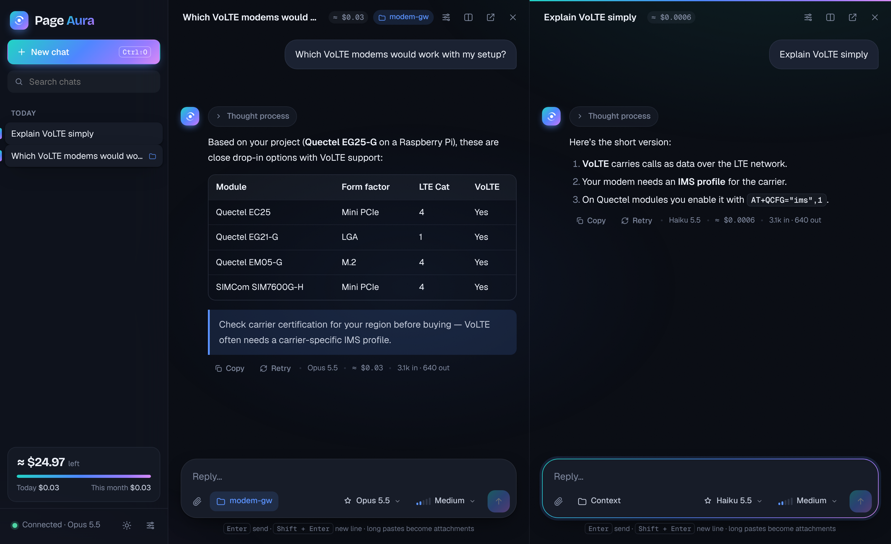
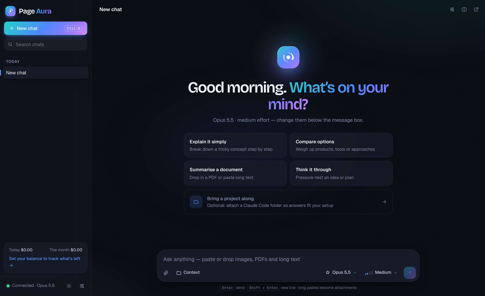
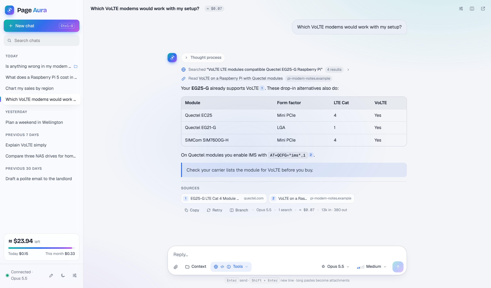
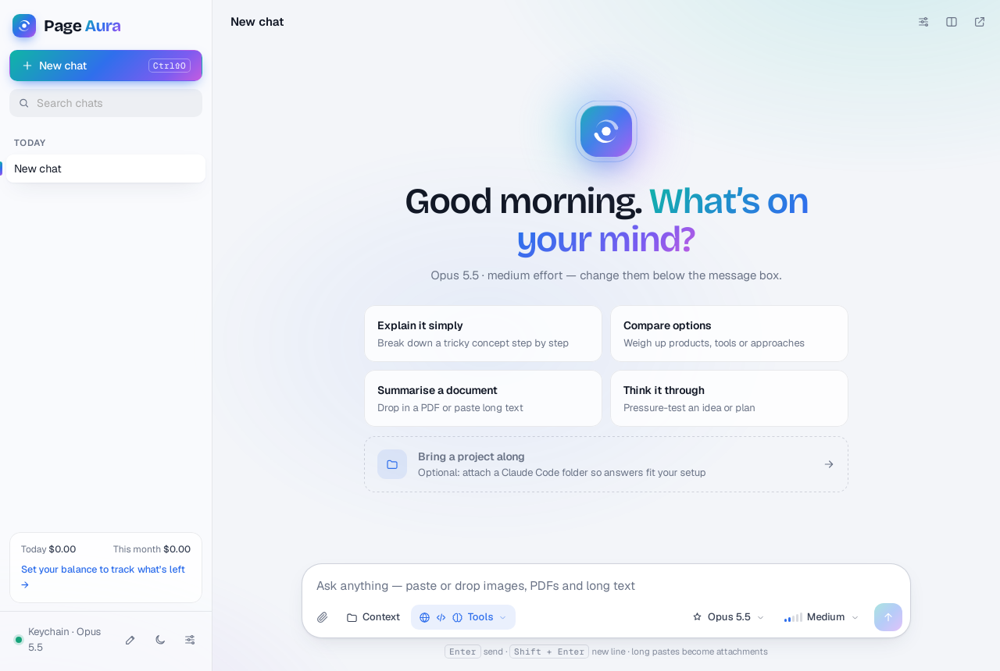
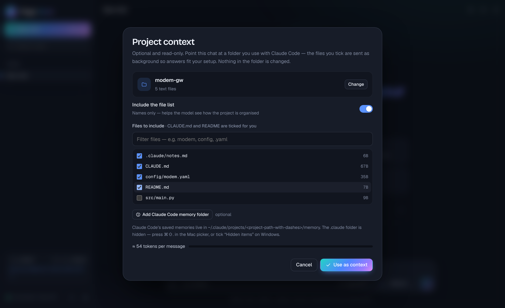
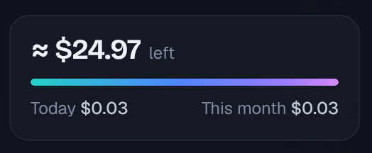

<p align="center">
  
</p>

<h1 align="center">Page Aura</h1>

<p align="center">
  <strong>A beautiful, secure, bring-your-own-key chat app for Anthropic’s Claude models.</strong><br>
  Several chats side by side · pick the model and effort for each one · photos, PDFs and long text ·
  optional project context from your local folders · a live estimate of what you’re spending.
</p>

<p align="center">
  Two ways to run it: <strong>one HTML file</strong> you just open, or a <strong>desktop app</strong> for Windows, macOS and Linux · no server · no sign-up · locked down so your key can only ever reach <code>api.anthropic.com</code>
</p>

<p align="center">
  
  <br><sub>Two chats running side by side on different models. The left one uses a project folder as background context. (Demo data.)</sub>
</p>

---

## Contents

- [Why we built Page Aura](#why-we-built-page-aura)
- [What it offers at a glance](#what-it-offers-at-a-glance)
- [Getting started](#getting-started)
- [Desktop app (Windows, macOS, Linux)](#desktop-app-windows-macos-linux)
  - [Get the desktop app](#get-the-desktop-app)
- [Features in depth](#features-in-depth)
  - [Multiple chats at once](#multiple-chats-at-once)
  - [Choosing the model and effort](#choosing-the-model-and-effort)
  - [Images](#images)
  - [Long text, documents and PDFs](#long-text-documents-and-pdfs)
  - [Project context from your own folders](#project-context-from-your-own-folders)
  - [Reading replies](#reading-replies)
- [API credits: cost tracking and the balance gauge](#api-credits-cost-tracking-and-the-balance-gauge)
- [Limits you should know about](#limits-you-should-know-about)
- [Security](#security)
- [How it works under the hood](#how-it-works-under-the-hood)
- [Troubleshooting](#troubleshooting)
- [Roadmap](#roadmap)
- [Disclaimer](#disclaimer)

---

## Why we built Page Aura

Page Aura exists for three reasons.

### 1. Put your monthly API credit to work, in a real conversation

Our Anthropic plan comes with a monthly allowance of API credit, for us the same value as what the plan itself costs. That's real money each month, and most of it went unused. The API is built for developers: out of the box you either write code or use the Console's test playground, which was never meant for everyday conversation.

Page Aura turns that credit into a proper chat experience, the kind you'd expect from a polished desktop app:

- **Several conversations at once.** Chats sit side by side or in their own windows, each answering at the same time, so you can research in one, ask a quick question in another, or compare two models on the same question.
- **Your choice of model and effort for each chat.** Use the most capable model at maximum effort when it matters, and something fast and cheap for "what's the capital of Peru?"
- **Real material, not just typing.** Paste a screenshot, drop in a 40-page PDF datasheet, or paste a giant log. Long pastes become tidy attachments instead of flooding the message box.
- **Know what you're spending.** The API won't tell apps your remaining balance, so Page Aura estimates the cost of every reply and chat, and keeps a **balance gauge** that counts down from your Console balance. Your monthly allowance stops being a mystery.

### 2. Ask questions with the context you've already built

If you build with Claude Code, your projects already describe themselves: `CLAUDE.md`, READMEs, config files and Claude Code's own saved memories record exactly what you use (which modem, which board, which vendor, which conventions).

Sometimes you step out of coding to ask a *research* question, like *"list modems that support VoLTE and would work with my setup"*. The answer should know your setup, without you copying and pasting files into a chat window. Page Aura lets you **point a chat at a project folder**, read-only and only when you choose, and pick exactly which files the model sees. You get answers that fit your situation, in a chat that can't touch your code.

### 3. Security, security, security

In an age when everything seems to get hacked, an app that holds an API key tied to your credit card must be secure by design, not secure by promise. Page Aura is built so that **even if something goes wrong, your key has nowhere to go**:

- **No server, no account, no telemetry.** Your browser talks directly to Anthropic. There's no middleman to breach.
- **A strict Content Security Policy.** The page may only connect to `api.anthropic.com`, so even injected code couldn't send your key anywhere else.
- **No live third-party code near your key.** The official Anthropic library is built into the file, and every other library is locked to a cryptographic fingerprint.
- **Optional passphrase encryption.** Your saved key is encrypted with AES-256, so a copied browser profile or a nosy script finds only scrambled data.
- **Secret-aware project context.** `.env` files and private keys are never offered, and anything that looks like a password or token needs your confirmation before it's sent.

[Read the full security model ↓](#security)

## What it offers at a glance

| | |
|---|---|
| 🪟 **Multiple chats** | Up to 4 side by side, plus any number of pop-out windows. Each one streams its replies independently. |
| 🎚️ **Model and effort for each chat** | Opus 5.5, Fable 5.1, Sonnet 5.5, Haiku 5.5 (and previous generations), with effort from *Low* to *Max* |
| 🖼️ **Images** | PNG, JPEG, GIF, WebP: paste, drop or attach. Large photos are resized automatically. |
| 📄 **Long text and files** | Pastes over about 4,000 characters become attachments. Text, code and config files, and PDFs up to 30 MB. |
| 📁 **Project context** | An optional, read-only project folder for a chat. You choose exactly which files are sent. It can include Claude Code's memory folder. |
| 🌐 **Web search** | Live search and page reading through Anthropic’s built-in tools, with numbered citations and a list of sources |
| 🧪 **Code & files** | Analyse spreadsheets and data in a secure sandbox, draw charts, and create Word, Excel, PowerPoint and PDF files to download |
| 🧠 **Memory** | Remembers useful facts across chats (stored in your browser), with a manager to view, edit or delete them |
| 🔌 **Connected apps** | Connect Notion, GitHub, Linear and other services that offer a remote MCP server |
| 💭 **Thought process** | Collapsible summaries of the model's reasoning, streamed live |
| 💲 **Cost tracking** | An estimated cost for every reply and every chat, plus spend today and this month |
| ⛽ **Balance gauge** | Enter your Console balance once, and it counts down as you chat |
| 🛟 **Refusal fallback** | Optionally retries a declined request on another model, server-side |
| 💾 **Saved locally** | Chats survive restarts. They're stored in your browser (IndexedDB). |
| 🌗 **Light and dark** | Follows your system setting, with a manual toggle |
| 🔐 **Locked down** | A strict security policy, embedded and fingerprinted code, optional AES-256 key encryption, secret filtering |
| 📱 **Works on phones** | A responsive layout with a slide-out sidebar |

<table>
  <tr>
    <td width="50%"><br><sub>Welcome screen with starter suggestions</sub></td>
    <td width="50%"><br><sub>Light theme</sub></td>
  </tr>
</table>

---

## Getting started

### What you need
- An **Anthropic API key** and some API credit. Create both in the [Anthropic Console](https://console.anthropic.com).
- A modern browser. **Chrome or Edge is recommended**, because the project-folder feature works best there. Firefox and Safari work too; see [Limits](#limits-you-should-know-about).

### Run it
1. Download `page-aura.html` from this repository.
2. Double-click it to open it in your browser.
3. Paste your API key when asked, then click **Save**.
4. Optionally, click the card at the bottom of the sidebar and enter your current Console balance so the gauge can track it.

That's it. There's nothing to install.

> **Tip:** if your browser restricts pages opened directly from disk, serve the folder locally instead:
> ```bash
> python3 -m http.server 8000
> ```
> Then open <http://localhost:8000/page-aura.html>. Chats and settings are stored per address, so pick one way of opening the app and stick with it.

### Keyboard shortcuts

| Shortcut | Action |
|---|---|
| <kbd>Enter</kbd> | Send |
| <kbd>Shift</kbd> + <kbd>Enter</kbd> | New line |
| <kbd>Ctrl/⌘</kbd> + <kbd>Shift</kbd> + <kbd>O</kbd> | New chat |
| <kbd>Ctrl/⌘</kbd> + <kbd>\\</kbd> | New chat side by side |
| <kbd>Ctrl/⌘</kbd>-click a chat in the sidebar | Open it side by side |
| <kbd>Esc</kbd> | Close a menu or dialog |

---

## Desktop app (Windows, macOS, Linux)

The standalone file is perfect for "open it and get going". The **desktop app** is the same interface, built with [Tauri 2](https://tauri.app), with the browser's limits removed:

| | Standalone file | Desktop app |
|---|---|---|
| **API key** | Browser storage (optionally AES-256 encrypted with a passphrase) | **Your system keychain** (macOS Keychain, Windows Credential Manager, Linux Secret Service). Requests go through the app's Rust core, which adds the key, so **the interface never sees your key at all** |
| **Connected-app tokens** | Browser storage (encrypted with your passphrase when on) | **System keychain**, inserted by the Rust core on the way out |
| **Chats and memory** | Browser storage: tied to one browser, lost if site data is cleared | **A real database file** (SQLite) in the app's data folder. No browser limits, easy to back up |
| **Project folders** | File picker each time; hidden folders are awkward | **Native folder picker**, remembered folders, files read live from disk, and **Claude Code's memory found automatically** |
| **Other windows** | Browser pop-ups | Native windows |
| **Links and downloads** | Browser tabs and downloads | Links open in your browser; generated files save through a native **Save** dialog |
| **Size** | ~430 KB file | ~10 MB installer |


<sub>The desktop app on Linux (first launch, Settings open).</sub>

Both versions share one interface file (`page-aura.html`). The page detects when it's running inside the desktop app and switches to the keychain, database and native folders. Everything else, including every feature in this README, works the same.

### Get the desktop app

Page Aura is free and community-built, so the installers **aren't code-signed**: signing costs money every year (an Apple Developer account, a Windows signing certificate), and nobody is making money here. That leaves two easy options.

#### Option A: build it yourself (recommended: free, and no warnings)

Your computer only warns about apps that were *downloaded*. An app you build on your own machine opens normally. It takes about 10 minutes the first time, and you only need to do it once per update.

**1. Install the tools (one time)**

| System | What to install |
|---|---|
| **Windows 10/11** | [Node.js LTS](https://nodejs.org) · [Rust](https://rustup.rs) (run `rustup-init.exe` and accept the defaults) · [Microsoft C++ Build Tools](https://visualstudio.microsoft.com/visual-cpp-build-tools/) (tick **"Desktop development with C++"**). WebView2 is already part of Windows 10/11. |
| **macOS** | [Node.js LTS](https://nodejs.org) · [Rust](https://rustup.rs) · Apple's command line tools: `xcode-select --install` |
| **Linux** (Debian/Ubuntu) | [Node.js LTS](https://nodejs.org) · [Rust](https://rustup.rs) · `sudo apt install libwebkit2gtk-4.1-dev libayatana-appindicator3-dev librsvg2-dev libsecret-1-dev libdbus-1-dev build-essential pkg-config`. Other distributions: see [Tauri's prerequisites](https://tauri.app/start/prerequisites/). |

**2. Build it**

```bash
git clone https://github.com/roysinclair/page-studio-apps.git
```

```bash
cd page-studio-apps/desktop
```

```bash
npm ci
```

```bash
npx tauri build
```

**3. Install what it made.** Everything ends up in `desktop/src-tauri/target/release/bundle/`:
- **Windows:** `msi/` or `nsis/`. Double-click the installer.
- **macOS:** `macos/Page Aura.app`. Drag it to Applications (or use the `.dmg` in `dmg/`).
- **Linux:** `deb/`, `rpm/` or `appimage/`.

To update later: `git pull`, then run `npm ci` and `npx tauri build` again.

#### Option B: download a ready-made build (and click past the warning once)

Download the installer for your system from the repository's **Releases** page, or from **Actions → Desktop app → latest run → Artifacts**:
- **Windows:** `.msi` or `-setup.exe`
- **macOS:** `.dmg` (one universal build for Apple silicon and Intel)
- **Linux:** `.deb`, `.rpm` or `.AppImage`

**Check the download first (recommended).** Each build comes with a `SHA256SUMS.txt` file. Compare it with your file's fingerprint:

| System | Command |
|---|---|
| macOS / Linux | `shasum -a 256 <downloaded file>` |
| Windows (PowerShell) | `Get-FileHash <downloaded file> -Algorithm SHA256` |

If the fingerprints match, the file is exactly what GitHub built from this repository's code.

**Then open it. You'll see a warning once:**

- **macOS:** open the `.dmg` and drag **Page Aura** to Applications. Double-click it; macOS says it can't verify the developer, so click **Done**. Then open **System Settings → Privacy & Security**, scroll down to the message about Page Aura, click **Open Anyway**, and confirm with your password. You only do this once.
  *Prefer Terminal?* `xattr -dr com.apple.quarantine "/Applications/Page Aura.app"` removes the downloaded tag, after which it opens normally.
- **Windows:** when the blue **"Windows protected your PC"** screen appears, click **More info → Run anyway**.
- **Linux:** no warning. Install the `.deb` with `sudo apt install ./Page*.deb`, or make the AppImage executable (`chmod +x Page*.AppImage`) and run it.

Then open the app, paste your API key in **Settings**, and it's saved straight into your system keychain.

> **Why the warning?** macOS and Windows trust apps whose developer has paid for a signing identity. It doesn't mean anything is wrong with the app. The checksum and the open source code are how you verify Page Aura instead.

### Moving from the standalone file to the desktop app

In the standalone file: **Settings → Your data → Export backup**. In the desktop app: **Settings → Your data → Import backup**. Chats and memories come across; add your API key again (it isn't included in backups, by design).

### Automatic builds

**To publish a release:** open the **Actions** tab, choose **Desktop app**, click **Run workflow**, type a version such as `v0.1.0`, and run it. GitHub builds the Windows, macOS and Linux installers on its own machines, and creates a release containing the standalone `page-aura.html`, every installer and SHA256 checksums. The release is published only if all three platforms build successfully, and its notes come from `docs/releases/<version>.md`. Pushing a tag like `v0.1.0` does the same. Run it with the version left empty for a test build without a release. Use `npx tauri dev` inside `desktop/` to run the app without packaging it.

---

## Features in depth

### Multiple chats at once

- **Side by side:** click the split icon in a chat's header, use <kbd>Ctrl/⌘</kbd> + <kbd>\\</kbd>, or <kbd>Ctrl/⌘</kbd>-click a chat in the sidebar. Up to **4** chats share the window. The focused one is marked with a gradient line.
- **Pop-out windows:** the ↗ button opens a chat in its own browser window, with no sidebar. Windows keep each other updated: a chat changed in one appears in the others.
- **Independent streaming:** every chat streams on its own, so you can ask three models three different things and watch them all answer at once. A pulsing dot in the sidebar marks chats that are still replying.
- **Rename** by clicking a chat's title. **Delete** from the sidebar (with a confirmation step). **Search** with the box at the top of the sidebar. Chats are grouped into *Today*, *Yesterday*, *Previous 7 days* and so on.
- **Instructions for each chat:** the sliders icon opens that chat's system prompt, so one chat can be "a terse hardware engineer" while another is "a patient tutor".

### Choosing the model and effort

Both pickers sit in the message box, and every chat remembers its own choice.

| Model | Best for | Price (input / output per 1M tokens) |
|---|---|---|
| **Opus 5.5** *(default)* | A smart all-rounder: research, writing, analysis | $4 / $20 |
| **Fable 5.1** | The hardest, longest reasoning tasks | $10 / $50 |
| **Sonnet 5.5** | Fast and capable everyday work | $2 / $10 |
| **Haiku 5.5** | Quick questions, very low cost | $0.10 / $0.50 |
| Opus 5 · Sonnet 5 | Previous generation | $5 / $25 · $2 / $10 |

Once your key is saved, the model list is refreshed from the API, so it only shows models your account can use.

**Effort** controls how much the model thinks before answering, which affects quality, speed and cost:

| Effort | What it means |
|---|---|
| ▂ **Low** | Quick, direct answers. The cheapest option. |
| ▂▃ **Medium** *(default)* | Balanced. Fine for most questions. |
| ▂▃▅ **High** | Thinks problems through |
| ▂▃▅▆ **Extra high** | Deep work: slower, more thorough |
| ▂▃▅▆█ **Max** | Everything it's got. Use it when being right matters more than cost. |

### Images

- **Formats:** PNG, JPEG, GIF, WebP.
- **Three ways in:** paste a screenshot straight from the clipboard, drag a file anywhere onto a chat, or use the 📎 button.
- **Automatic resizing:** images with a longest side over 2048 px, or files over about 3.7 MB, are scaled down and compressed in your browser before sending. That keeps them under the API's 5 MB limit for each image and avoids paying for detail the model doesn't use.
- Each image shows as a thumbnail before you send. In the conversation, click any image to view it full size.

### Long text, documents and PDFs

- **Long pastes become attachments.** Paste more than about **4,000 characters** (a log, an article, a whole file) and it turns into a tidy *"Pasted text 1"* card showing its length, instead of flooding the message box. Shorter pastes go in as normal text.
- **Text and code files:** `.txt`, `.md`, `.csv`, `.json`, `.yaml`, source code, config files. Anything that's text is sent as a titled document, so the model knows what it's reading.
- **PDFs** up to **30 MB** in this app. The API reads both the text and the page images, so charts and scanned pages work too. The API itself caps a request at 32 MB and 600 pages.
- Binary files that aren't images or PDFs (`.zip`, `.exe` and so on) are politely refused.

### Project context from your own folders


<sub>Choosing which files from a project folder to share with a chat. (Demo folder.)</sub>

This is the feature that sets Page Aura apart. If you use **Claude Code**, your projects already describe themselves in `CLAUDE.md`, `README` and config files. Page Aura can use that knowledge in an ordinary chat, **only when you ask it to**.

**How to use it**
1. Click **📁 Context** in the message box, or **"Bring a project along"** on the welcome screen.
2. Choose a project folder, for example one on your Desktop that you've been using with Claude Code.
3. `CLAUDE.md`, `CLAUDE.local.md`, `AGENTS.md`, `README` and `.claude/*.md` are **ticked for you**. Use the filter to find and tick anything else that describes your setup, such as `config/modem.yaml`.
4. Optionally click **Add Claude Code memory folder** to include the memories Claude Code saved for that project. They live in `~/.claude/projects/<project-path-with-dashes>/memory`, a hidden folder: press <kbd>⌘</kbd><kbd>⇧</kbd><kbd>.</kbd> in the Mac file picker, or tick *Hidden items* on Windows.
5. Click **Use as context**. The chat header shows the folder's name, and the sidebar marks the chat with a folder icon.

**What gets sent:** only the files you tick, plus (optionally) a list of the folder's file names so the model understands how the project is laid out. They're sent as background in the system prompt, with an instruction that this chat is for questions and research, not for editing the project.

**What is never done:** Page Aura **never writes to, moves or deletes** anything in the folder. It can't run commands or edit code. It's a chat app, not a coding agent.

**Smart defaults:** dependency and build folders are skipped automatically: `node_modules`, `.git`, `dist`, `build`, `venv`, `__pycache__`, `target`, `.next` and so on. Only text files are offered.

**Size check:** a live meter shows roughly how many tokens the context adds to *every* message, and turns red above about 150k tokens. Caching makes repeated sends much cheaper (see [Cost](#api-credits-cost-tracking-and-the-balance-gauge)), but untick large files you don't need.

**Staying current:** in Chrome and Edge, Page Aura remembers your folders (*Recent*) and can **Re-read** a folder later to pick up changes Claude Code has made since. In other browsers it takes a one-time copy when you choose the folder.

### Web search and page reading

Turn the web on or off for each chat with the **🌐 Web** button in the message box. Page Aura uses Anthropic's **built-in server tools**, so the searching and page reading happen on Anthropic's side. Your browser still only ever talks to `api.anthropic.com`, and there's no extra service, search-engine account or key to manage.

| Mode | What the model can do |
|---|---|
| **Search and read pages** *(default for new chats)* | Search the web, then open and read the most useful pages and PDFs in full |
| **Search only** | Use search results, but not open full pages |
| **Off** | Answer from its own knowledge |

- **You see what it's doing:** *"Searching the web for 'VoLTE modems Quectel'…"*, then *"Searched … · 8 results"* (click to see every result) and *"Read …"* for each page it opened.
- **Citations:** claims taken from the web get numbered markers that link to the source, and a **Sources** list appears under the answer.
- **The model decides when to search.** Every message includes today's date and a short instruction to search for anything that may have changed since its training, like prices, versions or "latest" anything. Questions that don't need the web don't trigger a search.
- **A cap on searches per reply:** up to 3, 5 (default) or 10. Long research that hits the API's internal step limit is resumed automatically.
- **Smart filtering:** on Opus, Sonnet and Fable, the model strips irrelevant parts of results before reading them, which saves tokens. Haiku uses the basic tool versions.
- **Cost:** **$0.01 per search** plus the tokens for the results it reads. Reading pages costs tokens only. Each reply shows its number of searches, and the fee is included in its cost and in the balance gauge.
- **Safety rule:** in chats with **project context attached, page reading is paused** (search still works), so your private files and arbitrary web pages are never in the same conversation by default. You can allow it from the 🌐 menu if you trust what you're asking about.
- **Admin switch:** web search and page reading are on for every organisation unless an admin turned them off in the Anthropic Console (**Settings → Capabilities**).

### The Tools menu

Each chat has a **Tools** button in the message box. Its icons show what's on, and the menu turns each tool on or off for that chat:

| Tool | What it does | Default for new chats |
|---|---|---|
| 🌐 **Web** | Search and page reading (see above) | Search and read pages |
| 🧪 **Code & files** | Runs code in Anthropic's secure sandbox, which has no internet access | On |
| 🧠 **Memory** | Remembers facts across chats | On |
| 📁 **Ask to read project files** | Lets the model request files from an attached project folder, which you approve | On when a folder is attached |
| 🔌 **Connected apps** | Lets the model use apps you've connected in Settings | Off (switch on for each chat) |

Defaults are set in **Settings → Web access**.

### Code & files

- **Analyse your data:** attach `.xlsx`, `.csv`, `.docx`, `.json`, `.zip` and other data files. They're uploaded once through Anthropic's Files API and placed in the sandbox, where the model can open them with Python.
- **Real calculations and charts:** the model writes and runs code instead of guessing. The steps appear as a collapsible **Ran code** row showing each command and its output.
- **Create files:** ask for *"a 5-slide deck"*, *"an Excel model"*, *"a Word report"* or *"a PDF"*. Anthropic's built-in file-creation skills produce real `.pptx`, `.xlsx`, `.docx` and `.pdf` files. They appear as cards with a **Download** button, and images get a preview.
- **The sandbox carries on between messages:** files created earlier in a chat are still there for follow-ups, until the sandbox expires.
- **Cost:** code execution is **free when web search is also on** in the request. Otherwise every organisation gets **1,550 free sandbox hours a month**, then $0.05 an hour. That's effectively free for personal use; you pay the normal token costs.

### Memory

With Memory on, the model keeps notes in a private `/memories` folder that lives **only in your browser**. It checks them at the start of a task and saves durable facts as they come up, such as *"Roy's gateway uses a Quectel EG25-G"*.

- Every save shows in the chat as **Saved to memory · project.md**. Click it to open the **memory manager**, where you can read, edit or delete any memory, or clear everything. It's also in **Settings → Manage memory**.
- Memory works across all chats where it's on, and it never leaves your device except when it's sent to the model as part of a chat.

### Project files on request

When a project folder is attached, the model doesn't need everything sent up front. It sees the folder's file list and can **ask to read a specific file**:

- An approval card appears: *"The model wants to read **src/main.py** (1.2 KB)"*, with **Deny**, **Allow once** or **Always allow in this chat**.
- Secret files (`.env`, keys, credentials) are never shared, and a file that looks like it contains a secret always asks, even with "Always allow" on.
- This is cheaper than ticking everything (you only pay for files actually read) and safer (you see each file before it's shared).
- In Chrome and Edge the file is read live from disk. Other browsers use the copy taken when you chose the folder.

### Connected apps (MCP)

Connect services that offer a **remote MCP server** (Notion, GitHub, Linear, Asana and many others) in **Settings → Connected apps**: a name, the server's `https://` address and, if needed, an access token. Then switch the app on for a chat in its **Tools** menu.

- Anthropic connects to the app's server on your behalf, so your browser still only talks to `api.anthropic.com`.
- Each use shows as **Used Notion · search_pages**. Click it to see what was sent and returned.
- Tokens are stored like your API key, **encrypted with your passphrase** when that's on.
- Only connect servers you trust: they receive whatever the model sends them. Apps are off by default in every chat.
- Getting a token: most services provide one in their developer or integration settings. For servers that use OAuth sign-in, Anthropic's documentation recommends the MCP Inspector to obtain a token.

### Your documents, cited

- In new chats, text files and PDFs you attach have **citations switched on**. When the model quotes or relies on them, numbered markers point back to the exact passage, and the **Sources** list shows the document (and page, for PDFs).
- **PDFs over 5 MB are uploaded once** through the Files API and referenced by ID, instead of being re-sent with every message.
- When you delete a chat, the files it uploaded to Anthropic (and files it generated) are deleted from your Anthropic storage too.

### Reading replies

- **Live streaming** with a soft caret, and a "Thinking" indicator while the model reasons.
- **Thought process:** collapsible summaries of the model's reasoning. You can turn them off in Settings.
- **Rich formatting:** headings, lists, tables, quotes and links, all sanitised for safety. **Code blocks** have syntax highlighting, a language label and a one-click **Copy** button.
- **Copy**, **Retry** (generate the last reply again) and **Stop** (cancel mid-reply; the partial answer is kept).
- **Refusals and errors are explained in plain language.** A declined request is shown clearly and left out of the conversation history, so it doesn't derail later turns. API errors include hints, such as *"check your API key"* or *"rate limited, wait a moment"*.
- **Refusal fallback (optional, on by default):** for the models that support it, a declined request is retried on another model server-side, and the reply is marked when that happens.

---

## API credits: cost tracking and the balance gauge

### Why not just show the real balance?

Anthropic's API **doesn't let an ordinary API key read your remaining credit balance**. That's only shown on the Billing page of the Anthropic Console. There is an *Admin API* with a cost report, but it needs an organisation admin key that can also create and delete keys and manage members. Putting a key that powerful into a web page would be unwise, so Page Aura deliberately doesn't use it.

Page Aura **estimates** your spend precisely instead, and lets you anchor that estimate to your real balance.

### Cost of each reply and each chat

Every reply from the API reports exactly how many tokens it used. Page Aura multiplies those numbers by the model's published price:

```
cost = uncached input  × input price
     + cache writes    × input price × 1.25
     + cache reads     × cache-read price
     + output          × output price          (all per million tokens)
```

- Hover over any reply to see, for example, `Opus 5.5 · ≈ $0.03 · 3.1k in · 640 out`. The latest reply always shows it.
- The **chat header** shows a running total for the conversation, for example `≈ $0.08`.
- **Output includes thinking.** Reasoning tokens are billed as output, so higher effort costs more even when the visible answer is the same length.
- **Stopped replies count too.** If you press Stop, the tokens generated before you stopped are still billed, and still counted.
- Older chats show costs as well, because their token counts were saved.

### The balance gauge



1. Click the card at the bottom of the sidebar.
2. Enter the balance shown at **console.anthropic.com → Billing**, for example `25.00`.
3. From then on the card shows **≈ $24.97 left**, a progress bar, and spend **today** and **this month**.

- The bar turns **amber** when less than 10% (or under $2) is left, and **red** when the estimate reaches zero.
- Re-enter your balance whenever you check the Console to correct any drift. **Stop tracking balance** removes it.
- The gauge stays in sync across pop-out windows and survives restarts.

### How accurate is it?

It's an estimate, usually within a few cents over a session. It drifts because:

- **It only sees this app in this browser.** Other apps, devices, scripts or teammates using the same account aren't counted.
- **Prices are built into the app.** If Anthropic changes them, update the `PRICES` table in the file.
- Special cases, such as refusal fallbacks charged at the fallback model's rate, or long-context pricing tiers, are approximated.

### Tips to spend less

| Do this | Why |
|---|---|
| Use **Search only**, or a cap of 3, for quick look-ups | Each search costs $0.01, and every page read adds input tokens |
| Use **Haiku 5.5** or **Sonnet 5.5** for quick questions | It can cost 40× less than Opus for the same question |
| Keep **effort** at Low or Medium unless it's a hard problem | Higher effort means more thinking tokens, billed as output |
| Start a **new chat** when the topic changes | Every message re-sends the whole conversation as input |
| Tick only the **project files** you need | Context is sent with *every* message in that chat |
| Keep a conversation going rather than coming back hours later | Re-sent history is **cached for about 5 minutes**. Cached input costs a fraction of the normal rate, but the cache expires when idle. |
| Set a spend limit in the Console | A hard backstop that Page Aura can't provide on its own |

---

## Limits you should know about

### API limits (set by Anthropic)

| Limit | Value |
|---|---|
| Context window (current models) | Up to **1M tokens** for each conversation |
| Max output for each reply | **64,000** tokens by default in Page Aura, adjustable up to **128,000** in Settings |
| Image size | **5 MB** each (Page Aura resizes larger images automatically) |
| PDF | **32 MB** for each request, **600 pages** (Page Aura caps a single PDF at 30 MB) |
| Rate limits | Depend on your account's **usage tier**. When you exceed them you get an HTTP 429 *"rate limited"* error; wait and press Retry. |
| Credit | When your prepaid credit runs out, requests fail until you top up in the Console |

### App limits

| Limit | Value |
|---|---|
| Chats side by side | 4 in each window (use pop-out windows for more) |
| Project folder scan | First **4,000** entries, 10 folder levels deep. The file list shows 400 at a time; use the filter. |
| Long-paste threshold | About **4,000** characters becomes an attachment |
| Storage | Chats live in **this browser only**. They don't sync between devices or browsers, and clearing site data deletes them. |
| Folder re-reading | Chrome and Edge only. Firefox and Safari take a one-time snapshot. |
| Tools | Web, code in Anthropic's sandbox, memory, project-file reading (read-only, with approval) and connected apps. Nothing runs on your computer, and your project files are never changed. |

---

<a id="security"></a>
## Security

Page Aura holds the one thing an attacker would want: an API key that spends your money. Every design decision starts from that.

### The threat model in one table

| Threat | What Page Aura does |
|---|---|
| **A server gets breached** | There is no server. The app is a static file; your browser talks straight to `api.anthropic.com`. |
| **A CDN or library is compromised** (supply-chain attack) | The official **Anthropic SDK is embedded in the file**, not fetched at runtime. The other three libraries (marked, DOMPurify, highlight.js) are pinned to exact versions **with Subresource Integrity hashes**, so the browser refuses to run them if a single byte changes. |
| **Malicious code tries to steal the key** | A strict **Content Security Policy** only allows network connections to `https://api.anthropic.com`. Scripts can only run if they are the app's own (allowed by SHA-256 hash) or the three pinned libraries. Images can't load from other sites, forms can't post, and frames, plugins and workers are disabled. Even injected code can't phone home. |
| **A malicious reply** (prompt injection that tries to output HTML or script) | Model output is rendered as Markdown and **sanitised with DOMPurify**. The CSP blocks inline scripts as a second line of defence. Links open in a new tab with `noopener noreferrer`. |
| **Someone copies your browser profile, or another page on the same address reads storage** | With **passphrase protection** on, the key is stored only as **AES-256-GCM** ciphertext, with the encryption key derived from your passphrase (PBKDF2-SHA256, 600,000 iterations). The decrypted key exists only in memory for the open tab. **Lock now** wipes it. |
| **A malicious web page tries to coax out your data** (prompt injection through page reading) | Anthropic only lets the model open web addresses that already appeared in the conversation, never ones it invents. On top of that, Page Aura **pauses page reading in any chat that has project context attached**, unless you allow it. |
| **A web page or app result tries to plant false "memories"** | Every memory save is shown in the chat, and the memory manager lets you review, edit or delete anything. Memory lives only in your browser. |
| **A connected app is malicious or compromised** | Apps are off by default in every chat and must be switched on one chat at a time. Their tokens are encrypted with your passphrase, and every app call is shown in full in the chat. |
| **Uploaded files linger on Anthropic's servers** | Files uploaded for code or large PDFs are deleted from your Anthropic storage when you delete the chat. |
| **You accidentally share secrets through project context** | `.env`, private keys (`*.pem`, `id_rsa`…), `credentials`, `secrets.*`, `.npmrc`, Terraform state and similar files are **never listed or sent**. Every selected file is also scanned for things that look like API keys, tokens, private keys or `password=` lines, and you're asked to leave them out (the default) or knowingly send them. |
| **Your key leaks through referrers or third parties** | `no-referrer` is set everywhere. The only third parties contacted are cdnjs (pinned libraries) and Google Fonts (typeface files). Neither ever sees your key or your chats. |

### What's stored, and where

| Data | Where | Protection |
|---|---|---|
| API key | Your browser's local storage, or session-only if *Remember key* is off | Optional AES-256 passphrase encryption |
| Chats and attachments | Your browser's IndexedDB on this device | Never leaves the device except in requests to Anthropic |
| Project files | Read from disk only when you choose a folder | Only ticked files are sent, and secrets are filtered |
| Settings, spend ledger, balance | Local storage | No secrets |

### The desktop app's extra protections

- **The key never enters the interface.** The page holds only a placeholder; the Rust core adds the real key from the system keychain to each request. There is deliberately **no command that hands a secret back to the page**: it can store or delete secrets, never read them.
- **The core only talks to `https://api.anthropic.com/`.** Any other address is refused before a request is made.
- **Folder access is checked in Rust:** reads must stay inside a folder you chose (no `..` or symlink escapes), and secret files (`.env`, keys, credentials, `.ssh`) are refused there too, as a second line of defence behind the interface's own filters.
- **Tauri's permission model:** the interface gets only the core window features and opening `http(s)` links in your browser. Everything else goes through Page Aura's own narrow, checked commands.

### Honest limits

Security claims are only useful if they're precise:

- **This is a browser app.** If your computer or browser is already compromised (malware, a malicious extension with access to all sites), no web page can fully protect you. Use a browser profile without untrusted extensions.
- **Without a passphrase, the key sits in plain text** in your browser's storage on your device. Turn on encryption if others can use your computer or browser profile.
- **Anthropic sees what you send.** That's how the API works. Review Anthropic's data and privacy terms for your account.
- **GitHub Pages demos share an origin.** Every Pages site under `username.github.io` shares browser storage. If you use the hosted demo, turn on passphrase encryption, or host Page Aura on its own domain.
- **Direct browser access to the API** is an explicit opt-in that Anthropic requires for browser apps. That's appropriate for a personal app on your own device. Never deploy a copy with a key built in.

### Recommended setup

1. In the Anthropic Console, create a **dedicated API key** for Page Aura, ideally in its **own workspace with a monthly spend limit**. If it ever leaks, the damage is capped and you can revoke it without affecting anything else.
2. Turn on **Encrypt the saved key with a passphrase** in Settings.
3. Use **Lock now** when you step away. Closing the tab locks it too.

### Verify it yourself

Everything is in one readable file. To check the claims:
- Search `page-aura.html` for `Content-Security-Policy` to see exactly what the page may load and connect to.
- Open your browser's developer tools, then the **Network** tab, and use the app. You'll see requests only to `api.anthropic.com`, `cdnjs.cloudflare.com` and Google Fonts.
- `tools/update-csp.py` and `tools/build-sdk.sh` show how the script hashes and the embedded SDK are produced, so you can rebuild and compare.

## How it works under the hood

- **One file:** `page-aura.html` (HTML, CSS and an ES module). No build step.
- **Desktop app:** `desktop/` holds a Tauri 2 shell. Its Rust core (`desktop/src-tauri/src/`) provides the keychain (`secrets.rs`), the API bridge that streams responses back to the interface (`api.rs`), the SQLite store (`store.rs`) and checked folder access (`files.rs`). `desktop/scripts/prepare.mjs` copies `page-aura.html` into the app, so both versions always share one interface.
- **The official [`@anthropic-ai/sdk`](https://github.com/anthropics/anthropic-sdk-typescript) (0.135.0) is embedded in the file**, built with `tools/build-sdk.sh`. [marked](https://marked.js.org) (Markdown), [DOMPurify](https://github.com/cure53/DOMPurify) (sanitising) and [highlight.js](https://highlightjs.org) (code) load from cdnjs, pinned to exact versions with Subresource Integrity hashes. The Geist and Bricolage Grotesque fonts come from Google Fonts. An internet connection is needed for these and for the API.
- **A Content Security Policy** in the page lists every allowed source. If you edit an inline script, run `python3 tools/update-csp.py` to refresh its hashes, or the browser will refuse to run it.
- **Each request is streamed** with:
  - `thinking: { type: "adaptive", display: "summarized" }`: the model decides how much to think, and its reasoning comes back as readable summaries.
  - `output_config: { effort }`: the effort level you chose.
  - top-level `cache_control: { type: "ephemeral" }`: automatic prompt caching of the conversation so far.
  - `system`: the chat's instructions, plus the project context when one is attached.
  - `tools`: `code_execution` with the `xlsx`, `docx`, `pptx` and `pdf` skills in a reused `container`; the client-side `memory` tool (stored in IndexedDB); a custom `read_project_file` tool (approval-gated); `mcp_toolset` entries with `mcp_servers` for connected apps (beta `mcp-client-2025-11-20`); and Anthropic's `web_search` and `web_fetch` server tools when Web is on (the `_20260209` versions with smart filtering, or the basic versions on Haiku), with a per-reply cap and your time zone for local results.
  - `fallbacks: "default"` with the `server-side-fallback-2026-07-01` beta header, on models that support it, when refusal fallback is on.
- **The conversation history is sent back exactly as the API returned it,** including the thought-process data, so multi-turn reasoning stays intact.
- **Storage:** IndexedDB holds chats and remembered folders; localStorage holds settings, the spend ledger and your balance. A BroadcastChannel keeps windows in sync.

---

## Troubleshooting

| Problem | Fix |
|---|---|
| `401 — invalid x-api-key` | The key is wrong or was revoked. Paste it again in **Settings**. |
| `429 — rate limited` | You've hit your tier's limit. Wait a few seconds and press **Retry**. |
| `400` mentioning **fallback** | Your account may not have the fallback beta. Turn off **Auto-fallback on refusal** in Settings. |
| `529 — overloaded` | Anthropic is busy. Try again shortly. |
| "Couldn't reach the API" | Check your connection. If the file is open inside a preview or a sandboxed viewer, open it directly in your browser. |
| Chats are missing | They're stored per browser and per address. Make sure you opened the same file, from the same place, in the same browser. |
| The folder picker doesn't show `.claude` | It's a hidden folder: press <kbd>⌘</kbd><kbd>⇧</kbd><kbd>.</kbd> on Mac, or tick *Hidden items* on Windows. |
| No **Re-read** or **Recent** buttons for folders | Those need Chrome or Edge. |
| Forgot the passphrase | Click **Forgot passphrase** on the unlock screen, then enter your API key again. The old encrypted key is deleted. |
| The page is blank after editing the file | You changed an inline script; run `python3 tools/update-csp.py` to update the security policy hashes. |
| The balance looks off | Re-enter your Console balance. It only counts usage from this app in this browser. |

---

## Roadmap

Ideas we're considering:

- **Export and import** of all chats as a backup file
- **Save chats to a folder** you choose (and sync it through iCloud or Dropbox)
- **A memory panel:** standing notes that go with every chat
- **Edit and branch** an earlier message
- **Economy research mode:** Haiku does the searching and reading, then hands a sourced summary to your chosen model, so you pay Haiku rates for the bulky search results
- **Desktop phase 2:** local MCP servers (run apps on your own computer, not just remote ones), a global shortcut to summon Page Aura, notifications when long replies finish, and automatic updates

Contributions and suggestions are welcome. Open an issue.

---

## Disclaimer

Page Aura is an independent project. It is **not affiliated with, endorsed by, or sponsored by Anthropic**. *Claude*, *Claude Code* and the model names (Opus, Sonnet, Haiku, Fable) are trademarks of Anthropic, PBC, used here only to describe what the app works with. You are responsible for your API usage and costs, and for following [Anthropic's usage policies](https://www.anthropic.com/legal/aup).

Prices, limits and model availability shown in this README and in the app reflect Anthropic's published information at the time of writing. Check the Console and Anthropic's documentation for current figures.

## License

**Page Studio License.** See [`LICENSE`](LICENSE) for the full text.

In plain English:

| ✅ You can | ❌ You can't |
|---|---|
| Use Page Aura for free, personally or at work | Sell Page Aura, or a lightly modified copy of it, as your own product |
| Use it for commercial work and client projects | Charge for hosting it, or for a service whose value comes mainly from Page Aura |
| Share unmodified copies, and send changes back as contributions | Distribute modified versions or forks, or remove the copyright and licence notice |
| Include it inside a larger project, as long as that project's value doesn't come mainly from Page Aura | |

This summary is for convenience only; the `LICENSE` file is what counts. Page Aura is *source-available* rather than "open source" under the OSI definition. GitHub may list the licence as "Other".
