<p align="center">
  
</p>

<h1 align="center">Page Aura</h1>

<p align="center">
  <strong>A beautiful, secure, bring-your-own-key chat app for Anthropic’s Claude models.</strong><br>
  Several chats side by side · model and effort for each one · photos, PDFs and data files ·
  web search with sources · code, charts and Office files · memory · your own project context ·
  a live estimate of what you’re spending.
</p>

<p align="center">
  Two ways to run it: <strong>one HTML file</strong> you just open, or a <strong>desktop app</strong> for Windows, macOS and Linux.<br>
  No server · no sign-up · no third-party code at runtime · your key can only ever reach <code>api.anthropic.com</code>
</p>

<p align="center">
  <a href="https://github.com/roysinclair/page-studio-apps/releases/latest"><strong>⬇ Download the latest release</strong></a>
</p>

<p align="center">
  Part of a pair: <strong><a href="../orbit/README.md">Page Orbit</a></strong> builds, runs and fixes Anthropic Managed Agents. · <a href="../../README.md">Both apps</a>
</p>

<p align="center">
  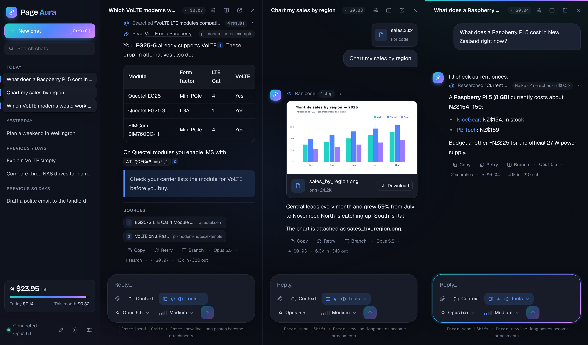
  <br><sub>Three chats at once: web search with sources, a chart made from an uploaded spreadsheet, and economy research. (Demo data.)</sub>
</p>

---

## Contents

- [Why we built Page Aura](#why-we-built-page-aura)
- [What it offers at a glance](#what-it-offers-at-a-glance)
- [Getting started](#getting-started)
- [Page Orbit: the sister app for agents](#page-orbit-the-sister-app-for-agents)
- [Desktop app (Windows, macOS, Linux)](#desktop-app-windows-macos-linux)
- [Features in depth](#features-in-depth)
- [API credits: cost tracking and the balance gauge](#api-credits-cost-tracking-and-the-balance-gauge)
- [Limits you should know about](#limits-you-should-know-about)
- [Security](#security)
- [How it works under the hood](#how-it-works-under-the-hood)
- [Troubleshooting](#troubleshooting)
- [Ideas and contributions](#ideas-and-contributions)
- [Disclaimer](#disclaimer) · [License](#license)

---

## Why we built Page Aura

Page Aura exists for three reasons.

### 1. Put your monthly API credit to work, in a real conversation

Our Anthropic plan comes with a monthly allowance of API credit, for us the same value as what the plan itself costs. That's real money each month, and most of it went unused. The API is built for developers: out of the box you either write code or use the Console's test playground, which was never meant for everyday conversation.

Page Aura turns that credit into a proper chat experience, the kind you'd expect from a polished desktop app: several conversations at once, your choice of model and effort for each, real material (photos, PDFs, spreadsheets), web search, code that makes charts and Office files, and an honest running total of what it all costs.

### 2. Ask questions with the context you've already built

If you build with Claude Code, your projects already describe themselves: `CLAUDE.md`, READMEs, config files and Claude Code's own saved memories record exactly what you use (which modem, which board, which vendor, which conventions).

Sometimes you step out of coding to ask a *research* question, like *"list modems that support VoLTE and would work with my setup"*. The answer should know your setup without you copying and pasting files. Page Aura lets you **point a chat at a project folder**, read-only and only when you choose. The model sees exactly the files you pick, and can ask for others, with your approval each time.

### 3. Security, security, security

An app that holds an API key tied to your credit card must be secure by design, not secure by promise. Page Aura is built so that **even if something goes wrong, your key has nowhere to go**:

- **No server, no account, no telemetry.** Your browser (or the desktop app) talks directly to Anthropic. There's no middleman to breach.
- **No third-party code at runtime.** Every library, including the official Anthropic SDK, is embedded in the file and checked against its published fingerprint when it's built in.
- **A strict Content Security Policy.** The page may only connect to `api.anthropic.com`, so even injected code couldn't send your key anywhere else.
- **Your key, protected.** In the desktop app it lives in your **system keychain** and the interface never sees it. In the standalone file it can be **encrypted with a passphrase** (AES-256).
- **Secret-aware project context.** `.env` files and private keys are never offered, and anything that looks like a password or token needs your confirmation.

[Read the full security model ↓](#security)

---

## What it offers at a glance

| | |
|---|---|
| 🪟 **Multiple chats** | As many side by side as you like (past what fits, the row scrolls sideways), plus pop-out windows. Each streams on its own. |
| 🎚️ **Model and effort per chat** | Opus 5.5, Fable 5.1, Sonnet 5.5, Haiku 5.5 (and previous generations), effort from *Low* to *Max* |
| ✏️ **Edit and branch** | Edit an earlier message and resend, or branch the conversation into a new chat and keep the original |
| 🖼️ **Photos, PDFs, data** | Paste, drop or attach images, PDFs, long text, spreadsheets and other data files |
| 🌐 **Web search** | Live search and page reading with numbered citations and a Sources list |
| 💸 **Economy research** | Haiku does the searching and reading at its low price; your chosen model writes the answer |
| 🧪 **Code & files** | Analyse data in a secure sandbox, draw charts, create Word, Excel, PowerPoint and PDF files |
| 📁 **Project context** | A read-only project folder for a chat, including Claude Code's memory; the model can ask for more files, with your approval |
| 🧠 **Memory** | The model remembers useful facts across chats; you can read, edit or delete every memory |
| 📝 **Standing notes** | Your own notes, sent with every chat (for example "I'm in New Zealand, prices in NZD") |
| 🔌 **Apps** | Connect remote MCP services (Notion, GitHub, Linear…) and, in the desktop app, **MCP servers on your own computer** |
| 💲 **Cost tracking** | Estimated cost of every reply and chat, plus a **balance gauge** that counts down from your Console balance |
| 🔄 **Sync and backup** | Keep chats, memories and notes in a folder in iCloud Drive, Dropbox, OneDrive or Google Drive; export and import backups |
| 🖥️ **Desktop app** | Windows, macOS and Linux: system keychain, database storage, native folders, global shortcut, notifications, optional auto-updates |
| 🔐 **Locked down** | Strict security policy, embedded and fingerprinted code, keychain or AES-256 key storage, secret filtering, approvals |
| 🌗 **Light and dark** | Follows your system, with a toggle. Works on phones too. |

<table>
  <tr>
    <td width="50%">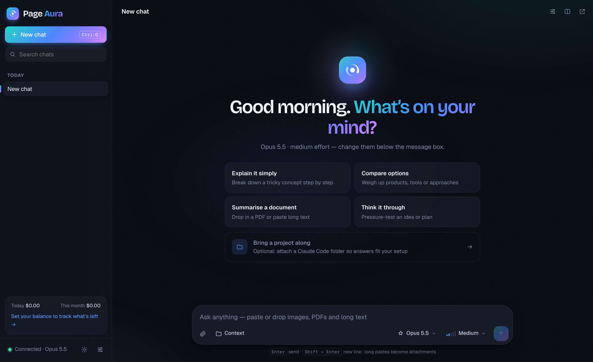<br><sub>Welcome screen</sub></td>
    <td width="50%">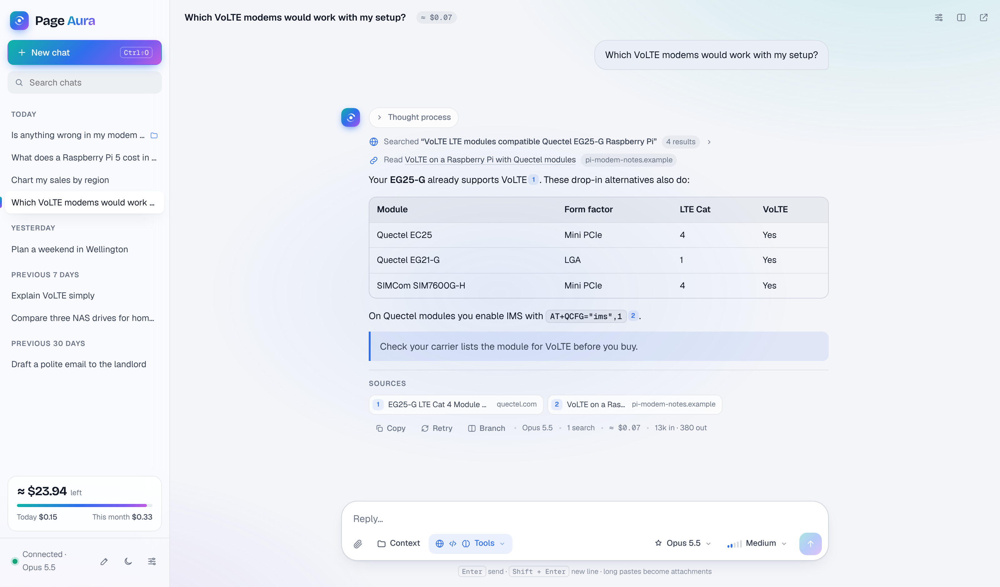<br><sub>Light theme</sub></td>
  </tr>
</table>

---

## Getting started

### What you need
- An **Anthropic API key** and some API credit. Create both in the [Anthropic Console](https://console.anthropic.com).
- For the standalone file, a modern browser. **Chrome or Edge is recommended**: project folders and folder sync work best there. Firefox and Safari work too ([limits](#limits-you-should-know-about)).

### Run the standalone file
1. Download **`page-aura.html`** from the [latest release](https://github.com/roysinclair/page-studio-apps/releases/latest) (or from this repository).
2. Double-click it to open it in your browser.
3. Paste your API key when asked, then click **Save**.
4. Optional: click the card at the bottom of the sidebar and enter your Console balance, so the gauge can track it.

There's nothing to install.

> **Tip:** if your browser restricts pages opened from disk, serve the folder instead with `python3 -m http.server 8000` and open <http://localhost:8000/page-aura.html>. Chats are stored per address, so pick one way of opening the app and stick with it.

### Keyboard shortcuts

| Shortcut | Action |
|---|---|
| <kbd>Enter</kbd> / <kbd>Shift</kbd> + <kbd>Enter</kbd> | Send / new line |
| <kbd>Ctrl/⌘</kbd> + <kbd>Shift</kbd> + <kbd>O</kbd> | New chat |
| <kbd>Ctrl/⌘</kbd> + <kbd>\\</kbd> | New chat side by side |
| <kbd>Ctrl/⌘</kbd>-click a chat in the sidebar | Open it side by side |
| <kbd>Ctrl/⌘</kbd> + <kbd>Enter</kbd> while editing a message | Resend it |
| <kbd>Ctrl/⌘</kbd> + <kbd>Shift</kbd> + <kbd>Space</kbd> (desktop app, from anywhere) | Bring Page Aura to the front |
| <kbd>Esc</kbd> | Close a menu or dialog |

---

## Page Orbit: the sister app for agents

Page Aura is for talking to a model. **[Page Orbit](../orbit/README.md)** is its sister app for Anthropic's **Managed Agents**: build, run and fix agents that work in their own cloud sandbox. Same design, same security rules, same key. See [both apps](../../README.md).

---

## Desktop app (Windows, macOS, Linux)

The standalone file is perfect for "open it and get going". The **desktop app** is the same interface, built with [Tauri 2](https://tauri.app), with the browser's limits removed:

| | Standalone file | Desktop app |
|---|---|---|
| **API key** | Browser storage, optionally AES-256 encrypted with a passphrase | **System keychain** (macOS Keychain, Windows Credential Manager, Linux Secret Service). The app's Rust core adds it to requests, so **the interface never sees your key** |
| **App tokens** | Browser storage (encrypted with your passphrase when on) | System keychain, inserted by the Rust core |
| **Chats, memory, notes** | Browser storage (tied to one browser) | A **SQLite database** in the app's data folder |
| **Sync folder** | Chrome and Edge | ✓ |
| **Project folders** | File picker; hidden folders are awkward | Native picker, remembered folders, live reads, **Claude Code memory found automatically** |
| **Apps on this computer** (local MCP servers) | – | ✓ with per-use approval, and **import from Claude Desktop** |
| **Global shortcut** | – | <kbd>Ctrl/⌘</kbd> + <kbd>Shift</kbd> + <kbd>Space</kbd> brings Page Aura to the front |
| **Notifications** | – | When a reply finishes while Page Aura is in the background |
| **Automatic updates** | – | Optional, signed ([setup](../updates.md)) |
| **Size** | ~690 KB file | 3–6 MB installer |

<table>
  <tr>
    <td width="60%">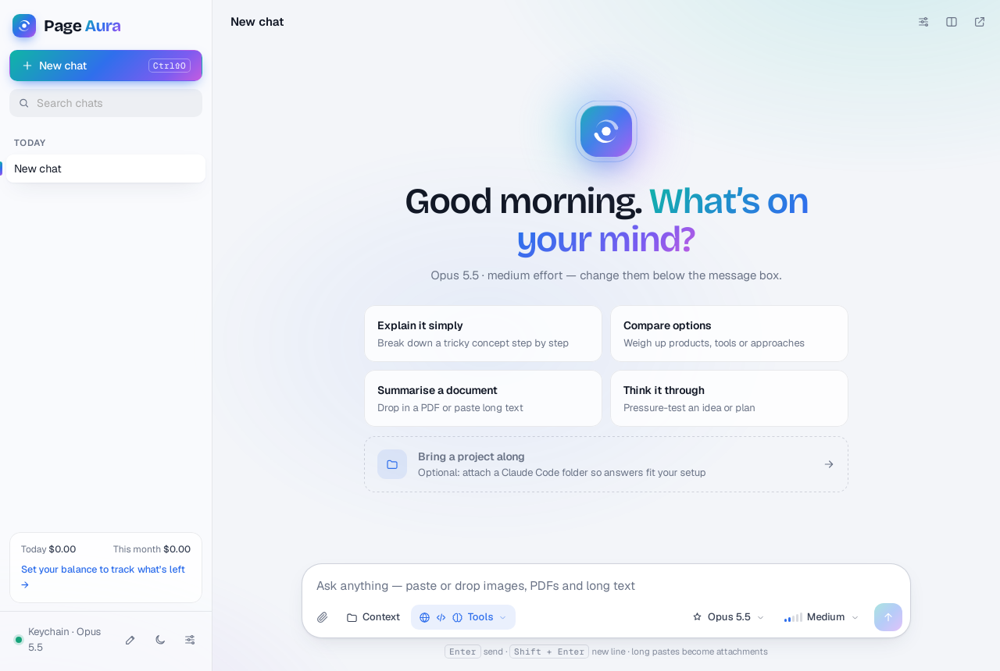<br><sub>The desktop app on Linux. "Keychain" in the sidebar means the key is in the system keychain.</sub></td>
    <td width="40%">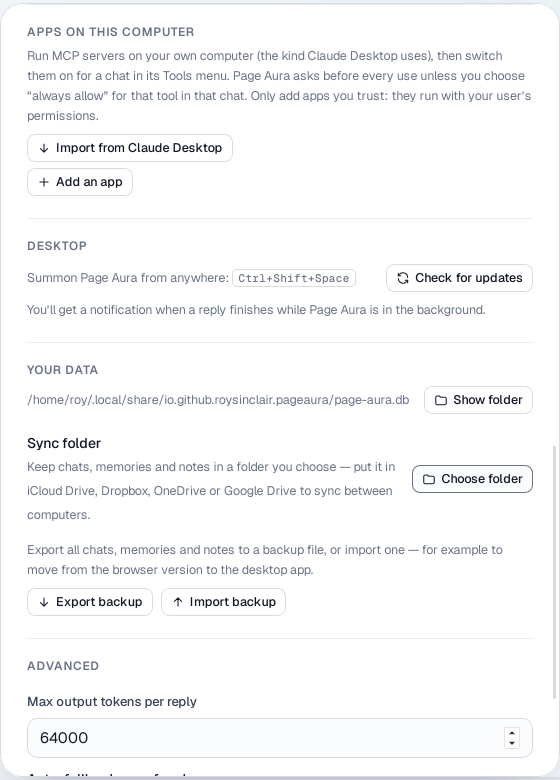<br><sub>Desktop-only settings</sub></td>
  </tr>
</table>

Both versions share one interface file (`page-aura.html`). The page detects when it's running inside the desktop app and switches to the keychain, database and native features. Everything else in this README works the same in both.

### Get the desktop app

Download it or build it yourself: both ways, and how to open the unsigned installers, are in **[Get the apps](../../README.md#get-the-apps)**.

### Moving from the standalone file to the desktop app

Either set both to the same **sync folder** (Settings → Your data), or use **Export backup** in the standalone file and **Import backup** in the desktop app. Chats, memories and notes come across. Add your API key again: keys are never included in backups or sync, by design.

### Releases and automatic builds

How releases are built and published is described in [Releases](../../README.md#releases).

---

## Features in depth

### Multiple chats at once

- **Side by side:** the split icon in a chat's header, <kbd>Ctrl/⌘</kbd> + <kbd>\\</kbd>, or <kbd>Ctrl/⌘</kbd>-click a chat in the sidebar. Up to **4** chats per window.
- **Pop-out windows:** the ↗ button opens a chat in its own window. Windows keep each other updated.
- **Independent streaming:** ask three models three things and watch them all answer. A pulsing dot marks chats still replying.
- **Rename** by clicking a chat's title; **delete** and **search** in the sidebar, where chats are grouped by date.
- **Instructions for each chat:** the sliders icon opens that chat's system prompt.

### Edit and branch

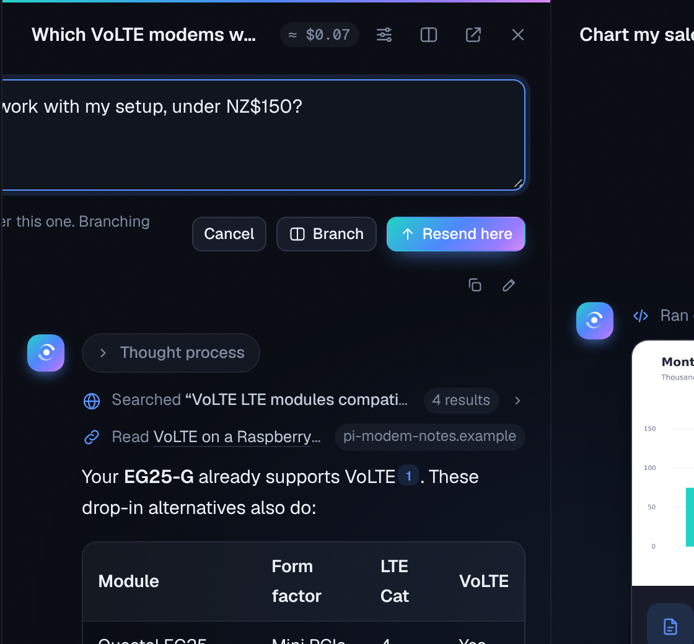

- **Edit any message you sent** (the pencil under it), then:
  - **Resend here:** replaces that message and everything after it, in this chat.
  - **Branch:** copies the chat up to that point, with your edit, into a **new chat beside it**. The original stays exactly as it was.
- **Branch from any reply:** the **Branch** button under a reply starts a new chat from that point, so you can explore "what if" without losing the thread.
- Branches keep the chat's model, tools, project context and instructions.

### Choosing the model and effort

Both pickers sit in the message box, and every chat remembers its own choice.

| Model | Best for | Price (input / output per 1M tokens) |
|---|---|---|
| **Opus 5.5** *(default)* | A smart all-rounder: research, writing, analysis | $4 / $20 |
| **Fable 5.1** | The hardest, longest reasoning tasks | $10 / $50 |
| **Sonnet 5.5** | Fast and capable everyday work | $2 / $10 |
| **Haiku 5.5** | Quick questions, very low cost | $0.10 / $0.50 |
| Opus 5 · Sonnet 5 | Previous generation | $5 / $25 · $2 / $10 |

Once your key is saved, the list is refreshed from the API, so it only shows models your account can use. **Effort** (*Low*, *Medium* (default), *High*, *Extra high*, *Max*) controls how much the model thinks before answering, which affects quality, speed and cost.

### Photos, long text, documents and data

- **Images:** PNG, JPEG, GIF, WebP. Paste from the clipboard, drop anywhere on a chat, or use 📎. Large photos are resized in your browser to stay under the API's 5 MB limit.
- **Long pastes become attachments:** paste more than about **4,000 characters** and it becomes a tidy *"Pasted text"* card.
- **Text and code files** are sent as titled documents.
- **PDFs** up to 30 MB. The API reads both text and page images. PDFs over 5 MB are uploaded once through Anthropic's Files API instead of being re-sent every message.
- **Data files** (`.xlsx`, `.csv`, `.docx`, `.json`, `.zip`…) go to the code sandbox when **Code & files** is on (see below).
- **Citations on your documents:** in new chats, attached text files and PDFs have citations switched on. Numbered markers point back to the exact passage (and page).

### The Tools menu

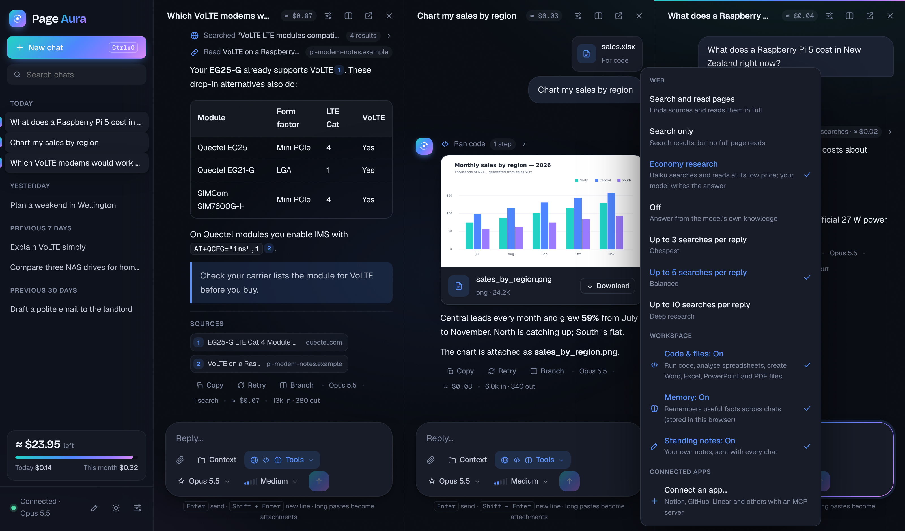

Each chat has a **Tools** button in the message box. Its icons show what's on, and the menu switches each tool for that chat. Defaults for new chats are in **Settings → Web access**.

| Tool | What it does | Default |
|---|---|---|
| 🌐 **Web** | *Search and read pages*, *Search only*, *Economy research* or *Off*; up to 3, 5 or 10 searches per reply | Search and read pages |
| 🧪 **Code & files** | Code in Anthropic's sandbox, and file creation | On |
| 🧠 **Memory** | Remembers facts across chats | On |
| 📝 **Standing notes** | Sends your notes with every message | On once you've written notes |
| 📁 **Ask to read project files** | The model can request files from an attached folder, with your approval | On when a folder is attached |
| 🔌 **Connected apps** | Remote MCP services you've added in Settings | Off |
| 🖥️ **Apps on this computer** *(desktop)* | Local MCP servers, with your approval for each use | Off |

### Web search and page reading

Page Aura uses Anthropic's **built-in server tools**, so searching and reading happen on Anthropic's side. Your browser still only ever talks to `api.anthropic.com`: no search-engine account, key or proxy.

- **You see what it's doing:** *"Searching the web for …"*, then *"Searched … · 4 results"* (click for every result) and *"Read …"* for each page.
- **Citations:** numbered markers link to sources, with a **Sources** list under the answer.
- **The model decides when to search.** Every message carries today's date and a nudge to search for anything that may have changed since training.
- **Long research** that hits the API's step limit is resumed automatically.
- **Cost:** **$0.01 per search** plus tokens for what it reads. Page reading is tokens only.
- **Safety rule:** in chats with **project context attached, page reading is paused** (search still works), so private files and arbitrary web pages don't share a conversation by default. You can allow it from the Tools menu.
- **Admin switch:** on unless an admin turned it off in the Anthropic Console (**Settings → Capabilities**).

#### Economy research

Search results are bulky, and they're billed at the rate of the model that reads them. In **Economy research** mode your chosen model gets a *research* tool instead of the web tools. When it needs facts, **Haiku 5.5** runs the searches, reads the pages, and hands back a short summary with numbered sources. Your model then writes the answer and cites them.

- Haiku reads the bulky results at about **1/40th of Opus's token price**. The $0.01 search fee is the same.
- The research step shows as *"Researched … · Haiku · 2 searches · ≈ $0.02"*. Click it to see Haiku's summary and sources. Its cost is included in the reply's total.
- A side benefit: the research request contains only the question, never your chat history or project files.

### Code & files

- **Analyse your data:** attached data files are uploaded once (Files API) into a sandbox where the model works on them with Python. The sandbox has no internet access.
- **Real calculations and charts:** steps appear as a collapsible **Ran code** row with each command and its output.
- **Create files:** ask for *"a 5-slide deck"*, *"an Excel model"*, *"a Word report"* or *"a PDF"*. Anthropic's file-creation skills make real `.pptx`, `.xlsx`, `.docx` and `.pdf` files, shown as cards with **Download** (images get a preview).
- **The sandbox carries on** between messages in a chat until it expires, then a fresh one starts.
- **Cost:** free when web search is also on; otherwise 1,550 free sandbox hours a month per organisation, then $0.05/hour. You pay normal token costs.

### Project context from your own folders

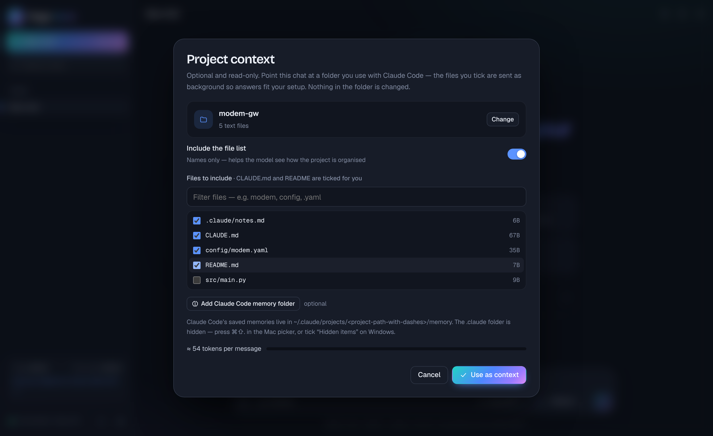

If you use **Claude Code**, your projects already describe themselves. Page Aura can use that in an ordinary chat, **only when you ask it to**.

1. Click **Context** in the message box (or **"Bring a project along"** on the welcome screen) and choose a project folder.
2. `CLAUDE.md`, `AGENTS.md`, `README` and `.claude/*.md` are **ticked for you**. Filter and tick anything else, such as `config/modem.yaml`.
3. Add **Claude Code's memory** for the project. The desktop app finds it automatically; in the browser, pick `~/.claude/projects/<project-path-with-dashes>/memory` (a hidden folder: press <kbd>⌘</kbd><kbd>⇧</kbd><kbd>.</kbd> in the Mac picker, or tick *Hidden items* on Windows).
4. Click **Use as context**.

- **Ask for other files:** with this on (the default), the model sees the file list and can request any other text file. You approve each one: **Deny**, **Allow once** or **Always allow in this chat**. Cheaper than ticking everything, and you see each file before it's shared.
- **Secrets stay out:** `.env`, keys, credentials and similar files are never listed or sent. Files that look like they contain a password or token are flagged, and always ask first.
- **Read-only:** Page Aura never writes to, moves or deletes anything in the folder.
- **Size check:** a live meter shows how many tokens the context adds to every message.

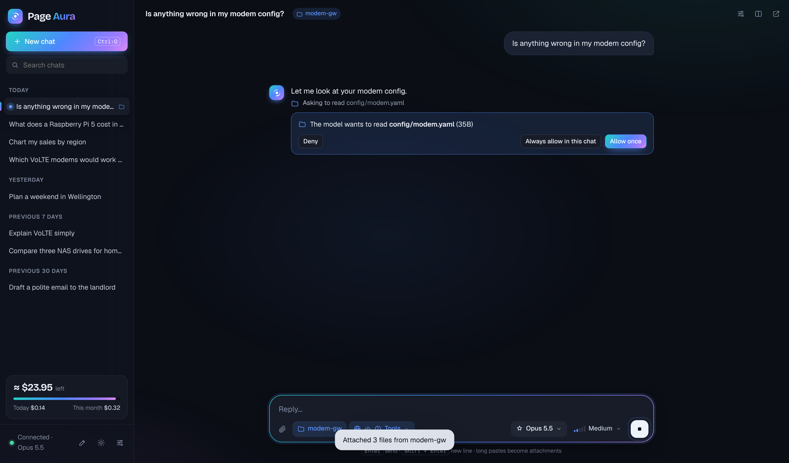

### Memory and standing notes

<table>
  <tr>
    <td width="50%">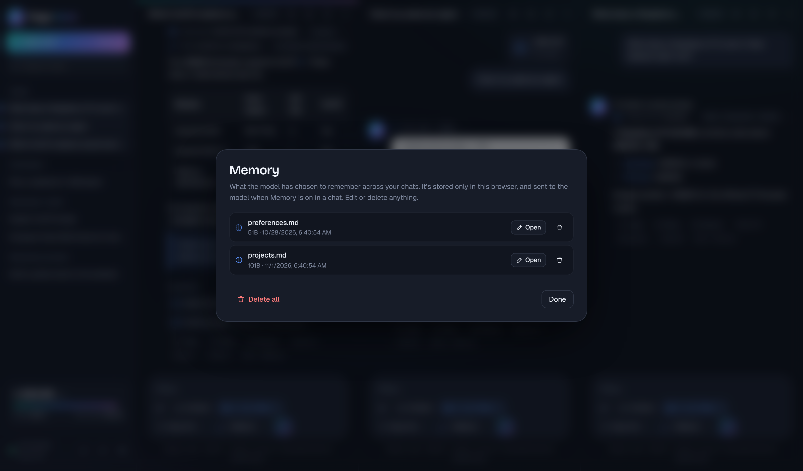<br><sub>Memory: what the model chose to remember</sub></td>
    <td width="50%">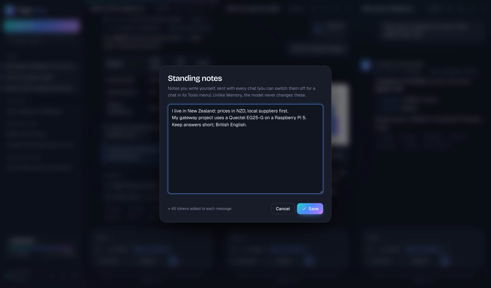<br><sub>Standing notes: what you tell it yourself</sub></td>
  </tr>
</table>

- **Memory:** with Memory on, the model keeps notes in a private `/memories` folder **on your device**. It checks them at the start of a task and saves durable facts as they come up. Every save shows in the chat (*"Saved to memory · projects.md"*). The **memory manager** (click a save, or **Settings → Manage memory**) lets you read, edit or delete anything.
- **Standing notes:** the ✎ button in the sidebar opens notes **you** write, sent with every chat: where you live, your projects, how you like answers. The model never changes them. Switch them off for a single chat in its Tools menu.

### Apps (MCP)

**Connected apps:** services with a **remote MCP server** (Notion, GitHub, Linear, Asana and many others). Add them in **Settings → Connected apps** with a name, the `https://` address and, if needed, an access token. Then switch an app on for a chat in its Tools menu. Anthropic connects to the server on your behalf. Each use shows as *"Used Notion · search_pages"*, and you can click it to see what was sent and returned.

**Apps on this computer (desktop app):** MCP servers that run on your own machine, the kind Claude Desktop uses (filesystem, git, databases and more).
- Add them in **Settings → Apps on this computer**, or click **Import from Claude Desktop** to bring across the ones you already use. Their environment variables (often API tokens) go into your keychain.
- Switch one on for a chat in its Tools menu. **Page Aura asks before every use**, showing the tool and its arguments, unless you choose *"Always allow this tool in this chat"*.
- Only add apps you trust: they run with your user account's permissions.

### Page Relay on this computer

[Page Studio](https://github.com/roysinclair/page) keeps your computer awake while agents work (Page Power) and pages your phone when a decision is yours (Page Relay). In the desktop app on macOS and Linux, **Settings ▸ Page Relay on this computer ▸ Link Page Aura to Page Relay** hands your chats to it:

- the computer stays awake while a reply is being written (an API stream dies if the computer sleeps);
- your phone is paged when a reply finishes while you're away, or when a chat asks to use an app on your computer;
- from the phone you can **Allow once** or **Deny** that request, send a message into the chat, or stop a reply ("always allow" is never offered remotely);
- with **Show my chats in Page Relay’s Sessions tab** on, your recent chats and their transcripts appear on the phone, end-to-end encrypted. Thinking, tool results and attachments are never sent.

Page Aura only talks to Page Studio on the same computer, over a private socket that only your user account can open. It never contacts the relay or the internet for this. In Page Studio, *Preferences ▸ Agents ▸ Page Aura* must be on (it is by default). The protocol is documented in [AURA-LINK.md](https://github.com/roysinclair/page/blob/main/docs/AURA-LINK.md).

### Sync and backup

- **Sync folder:** **Settings → Your data → Choose folder**. Pick a folder inside iCloud Drive, Dropbox, OneDrive or Google Drive, and your chats, memories and standing notes are kept there as plain JSON files (in a `Page Aura Sync` subfolder). Every computer pointed at the same folder stays in step.
  - The newest change wins, and deletions travel too.
  - The sidebar shows *"Synced with Dropbox · just now"*.
  - In the browser this needs Chrome or Edge. Each new browser session needs a click to resume sync, because browsers require permission again.
- **Backups:** **Export backup** saves everything (chats, memories, notes) to one file; **Import backup** merges one back in, keeping whichever copy of each chat is newer.
- **API keys are never synced or exported.**

### Reading replies

- Live streaming, collapsible **thought process** summaries (switchable in Settings), and rich formatting: tables, code with highlighting and a **Copy** button, quotes and links, all sanitised.
- **Copy**, **Retry**, **Branch** and **Stop** (the partial answer is kept).
- **Refusals and errors in plain language:** a declined request is shown clearly and left out of the conversation history. **Refusal fallback** (on by default) retries a declined request on another model where the API supports it.

---

## API credits: cost tracking and the balance gauge

### Why not just show the real balance?

Anthropic's API **doesn't let an ordinary API key read your remaining credit balance**; it's only on the Billing page of the Anthropic Console. The *Admin API* has a cost report, but needs an organisation admin key that can also create and delete keys and manage members, which is far too powerful to keep in a chat app. So Page Aura **estimates** your spend precisely and lets you anchor it to your real balance.

### Cost of each reply and each chat

Every reply reports exactly how many tokens it used. Page Aura multiplies them by the model's published price:

```
cost = uncached input  × input price
     + cache writes    × input price × 1.25
     + cache reads     × cache-read price
     + output          × output price          (per million tokens)
     + web searches    × $0.01
     + Haiku research  (economy mode, priced the same way)
```

- Each reply shows, for example, `Opus 5.5 · 2 searches · ≈ $0.04 · 4.1k in · 210 out`. The chat header shows the running total.
- Thinking is billed as output, so higher effort costs more even for the same visible answer.
- Stopped replies still count: the tokens generated before you stopped are billed.

### The balance gauge

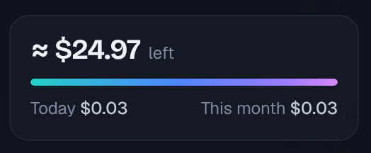

Click the card at the bottom of the sidebar and enter the balance from **console.anthropic.com → Billing**. From then on it shows what's left, plus spend today and this month.
- The bar turns **amber** below 10% (or $2) and **red** at zero.
- Re-enter your balance whenever you check the Console to correct drift.
- It's an estimate: it only sees this app on this device, and prices are built in (update the `PRICES` table if Anthropic changes them).

### Tips to spend less

| Do this | Why |
|---|---|
| Use **Economy research** for web questions on Opus or Fable | Haiku reads the bulky search results at a fraction of the price |
| Use **Search only**, or a cap of 3 searches | Each search costs $0.01, and every page read adds input tokens |
| Use **Haiku 5.5** or **Sonnet 5.5** for quick questions | Up to 40× cheaper than Opus |
| Keep **effort** at Low or Medium unless it's hard | Thinking tokens are billed as output |
| Start a **new chat** (or **Branch**) when the topic changes | Every message re-sends the conversation |
| Let the model **ask for project files** instead of ticking everything | You only pay for files it actually reads |
| Keep a conversation going rather than coming back hours later | History is cached for about 5 minutes, and cached input is much cheaper |
| Set a spend limit in the Console | A hard backstop Page Aura can't provide |

---

## Limits you should know about

### API limits (set by Anthropic)

| Limit | Value |
|---|---|
| Context window (current models) | Up to **1M tokens** per conversation |
| Max output per reply | **64,000** tokens by default, up to **128,000** in Settings |
| Images | **5 MB** each (resized automatically) |
| PDFs | **32 MB** per request, **600 pages** (Page Aura caps a PDF at 30 MB) |
| Uploaded files | 500 MB each; deleted from your Anthropic storage when you delete the chat |
| Rate limits | Depend on your **usage tier**; a 429 means wait and press Retry |
| Credit | When prepaid credit runs out, requests fail until you top up |

### App limits

| Limit | Value |
|---|---|
| Chats side by side | No limit. Each keeps a 380 px minimum width; past what fits, the row scrolls sideways |
| Saved chats | No limit. The desktop app keeps every chat in its own SQLite database (`page-aura.db` in the app's data folder); the browser keeps them in IndexedDB |
| Project folder scan | First 4,000 entries, 10 levels deep |
| Files read on request | Up to 300 KB each |
| Standalone storage | In the browser you use; use **sync** or **backups** to move between browsers or devices |
| Folder features in the browser | Re-reading folders and folder sync need Chrome or Edge |
| Apps on this computer | Desktop app only |
| Automatic updates | Desktop app, once a signing key is set up ([docs/updates.md](../updates.md)) |

---

<a id="security"></a>
## Security

Page Aura holds the one thing an attacker would want: an API key that spends your money. Every design decision starts from that.

### The threat model

| Threat | What Page Aura does |
|---|---|
| **A server gets breached** | There is no server. Your browser or the desktop app talks straight to `api.anthropic.com`. |
| **A CDN or library is compromised** (supply chain) | **Nothing is fetched at runtime.** The official Anthropic SDK and the three UI libraries (marked, DOMPurify, highlight.js) are embedded in the file. When they're built in, each is checked against its published SHA-512 fingerprint (`tools/vendor-libs.py`, `tools/build-sdk.sh`). |
| **Malicious code tries to steal the key** | A strict **Content Security Policy**: connections only to `https://api.anthropic.com`, scripts only if their SHA-256 hash is listed, no remote images, forms, frames, plugins or workers. Even injected code can't phone home. |
| **A malicious reply** (prompt injection that outputs HTML or script) | Replies are rendered as Markdown and **sanitised with DOMPurify**, with the CSP as a second line of defence. Links open in a new tab with `noopener noreferrer`. |
| **Someone copies your browser profile** | Standalone: with passphrase protection on, the key is stored only as **AES-256-GCM** ciphertext (PBKDF2-SHA256, 600,000 iterations); **Lock now** wipes it from memory. Desktop: the key is in the **system keychain** and never enters the interface. |
| **A web page tries to coax out your data** | Anthropic only lets the model open addresses already in the conversation. Page Aura also **pauses page reading in chats with project context**, and economy research sends Haiku only the question. |
| **False "memories" get planted** | Every memory save is shown in the chat, and you can review, edit or delete any memory. |
| **An app (remote or local) misbehaves** | Apps are off by default in every chat. **Local app tool calls need your approval**, showing the tool and arguments. Every app call is shown in full. Tokens and environment variables are kept in the keychain (desktop) or encrypted with your passphrase (standalone). |
| **You accidentally share secrets** | `.env`, private keys, credentials, `secrets.*`, `.npmrc`, Terraform state and similar files are never listed or sent, and are refused again by the desktop core. Files that look like they contain secrets are flagged and need your confirmation. |
| **Uploaded files linger** | Files uploaded for code or large PDFs are deleted from your Anthropic storage when you delete the chat (unless a branch still uses them). |
| **Leaks through referrers or third parties** | `no-referrer` everywhere. The only other site contacted is Google Fonts (typeface files), which never sees your key or chats. |

### What's stored, and where

| Data | Standalone file | Desktop app |
|---|---|---|
| API key | Browser storage, optionally AES-256 encrypted | System keychain |
| App tokens, local-app environment variables | Browser storage, encrypted with your passphrase when on | System keychain |
| Chats, memories, notes | Browser (IndexedDB / local storage) | SQLite file in the app's data folder |
| Sync folder (if you choose one) | Plain JSON files in that folder | Same |
| Project files | Read only when you choose a folder; only what you tick or approve is sent | Same, with checks in the Rust core |

### The desktop app's extra protections

- **The key never enters the interface.** The page holds a placeholder; the Rust core adds the real key from the keychain. There is **no command that returns a secret to the page**: it can store or delete secrets, never read them.
- **The core only sends requests to `https://api.anthropic.com/`.** Anything else is refused before a request is made.
- **Folder and sync access are checked in Rust:** project reads must stay inside a folder you chose (no `..` or symlink escapes), secret files are refused, and the sync folder only accepts Page Aura's own file names. Sync files are written atomically, so a cloud client never sees half a file.
- **Local apps** start only when you switch them on for a chat. Their environment variables are read from the keychain only when starting them.
- **Updates** (when enabled) are verified against your signing key before installing.
- **Tauri's permission model:** the interface gets only core window features and opening `http(s)` links in your browser. Everything else goes through Page Aura's own narrow, checked commands.

### Honest limits

- **A compromised computer or browser** (malware, a malicious extension with access to all sites) can't be fully defended against by any app. Use a browser profile without untrusted extensions.
- **Standalone without a passphrase:** the key sits in plain text in your browser's storage. Turn on encryption if others use your computer.
- **The sync folder holds your chats as plain JSON.** Anyone with access to that cloud folder can read them. Choose a folder only you can access. (An encrypted sync option is on the ideas list.)
- **Anthropic sees what you send**, as with any use of the API. Review your account's data terms.
- **Local apps run as you.** Only add MCP servers you trust.
- **GitHub Pages and similar shared hosts** share browser storage between sites on the same address. If you host the standalone file, use passphrase encryption or your own domain.

### Recommended setup

1. In the Anthropic Console, create a **dedicated API key** for Page Aura, ideally in its **own workspace with a monthly spend limit**.
2. Prefer the **desktop app** (keychain). In the standalone file, turn on **Encrypt the saved key with a passphrase**.
3. Use **Lock now** (standalone) when you step away.

### Verify it yourself

- Search `page-aura.html` for `Content-Security-Policy` to see exactly what the page may load and connect to.
- Open your browser's developer tools → **Network**, and use the app: requests go only to `api.anthropic.com` and Google Fonts.
- `tools/vendor-libs.py`, `tools/build-sdk.sh` and `tools/update-csp.py` show how the embedded code and the policy's hashes are produced, so you can rebuild and compare.

---

## How it works under the hood

- **One interface file:** `page-aura.html`: HTML, CSS and an ES module, with the SDK and UI libraries embedded. Nothing to build to use it.
- **Embedded code:** the official [`@anthropic-ai/sdk`](https://github.com/anthropics/anthropic-sdk-typescript) 1.4.0 (bundled by `tools/build-sdk.sh`), plus [marked](https://marked.js.org), [DOMPurify](https://github.com/cure53/DOMPurify) and [highlight.js](https://highlightjs.org) (embedded and fingerprint-checked by `tools/vendor-libs.py`). Fonts (Geist, Bricolage Grotesque) come from Google Fonts. After editing an inline script, run `python3 tools/update-csp.py`, or the browser will refuse to run it.
- **Each request is streamed** with adaptive thinking (summarised), your effort level, automatic prompt caching, and the system prompt (instructions, standing notes, project context, today's date). Tools are added per chat:
  - Anthropic server tools: `web_search` / `web_fetch`, and `code_execution` with the `xlsx`, `docx`, `pptx` and `pdf` skills in a reused `container`.
  - Client tools handled in the app: `memory`, `read_project_file`, `research` (economy mode), and local-app tools.
  - Remote MCP: `mcp_servers` + `mcp_toolset` (beta `mcp-client-2025-11-20`).
  - Optional refusal fallback (`fallbacks: "default"`).
  - Long turns that pause are resumed, and client-tool round trips are stored so history replays exactly as sent.
- **Desktop app:** `desktop/` holds a Tauri 2 shell. Its Rust core (`desktop/src-tauri/src/`):
  - `secrets.rs`: the keychain.
  - `api.rs`: the API bridge, streaming responses back to the interface.
  - `store.rs`: SQLite storage.
  - `files.rs`: checked folder access.
  - `sync.rs`: the sync folder.
  - `mcp.rs`: local MCP servers over stdio.
  - `desktop.rs`: notifications, the global shortcut and updates.

  `desktop/scripts/prepare.mjs` copies `page-aura.html` into the app, so both versions always share one interface. The same core builds **Page Orbit** with `src-tauri/tauri.orbit.conf.json` (its own name, icon, data folder and shortcut); `desktop.rs` picks the shortcut from the app's identifier.
- **Page Orbit:** written in `orbit/src/` and assembled into `page-orbit.html` by `tools/build-orbit.py`, which copies the embedded libraries from `page-aura.html` and writes the CSP hashes.
- **Releases:** `.github/workflows/desktop.yml` builds both apps on all platforms (third-party actions pinned to commits), adds checksums and publishes the release.

---

## Troubleshooting

| Problem | Fix |
|---|---|
| `401 — invalid x-api-key` | The key is wrong or was revoked. Paste it again in **Settings**. |
| `429 — rate limited` / `529 — overloaded` | Wait a moment and press **Retry**. |
| `400` mentioning **fallback** | Turn off **Auto-fallback on refusal** in Settings. |
| Web search or tools errors | An admin may have turned them off in the Console (**Settings → Capabilities**), or the model doesn't support them. Switch the tool off for that chat. |
| "Couldn't reach the API" | Check your connection. If the file is open in a preview, open it directly in your browser. |
| Chats are missing | Standalone chats are stored per browser and per address. Use the sync folder or a backup to move them. |
| **Sync paused** in the sidebar | Click it to grant folder access again (browsers ask once per session). |
| A **local app won't start** | The error shows the app's own message. Check the command works in a terminal. For `npx`/`uvx` apps, make sure Node.js or uv is installed. |
| The folder picker doesn't show `.claude` | It's hidden: press <kbd>⌘</kbd><kbd>⇧</kbd><kbd>.</kbd> on Mac, or tick *Hidden items* on Windows. The desktop app can find Claude Code memory automatically. |
| Forgot the passphrase (standalone) | **Forgot passphrase** on the unlock screen, then add your key again. |
| "Automatic updates aren't set up" | That build has no signing key; see [docs/updates.md](../updates.md), or update by downloading the new release. |
| The page is blank after editing the file | You changed an inline script; run `python3 tools/update-csp.py`. |
| A developer-tools message about a blocked `.map` file | From older versions that loaded libraries from a CDN; current versions embed them. Harmless either way. |

---

## Ideas and contributions

Everything on the original roadmap has shipped. Ideas being considered next:

- **Encrypted sync folder** (chats encrypted with a passphrase before they reach the cloud folder)
- **Sign in to connected apps with OAuth**, instead of pasting tokens
- **Voice input**, and reading replies aloud

Suggestions, bug reports and pull requests are welcome. Please open an issue.

---

## Disclaimer

Page Aura is an independent project. It is **not affiliated with, endorsed by, or sponsored by Anthropic**. *Claude*, *Claude Code*, *Claude Desktop* and the model names (Opus, Sonnet, Haiku, Fable) are trademarks of Anthropic, PBC, used here only to describe what the app works with. You are responsible for your API usage and costs, and for following [Anthropic's usage policies](https://www.anthropic.com/legal/aup).

Prices, limits and model availability reflect Anthropic's published information at the time of writing. Check the Console and Anthropic's documentation for current figures.

## Local models (Ollama)

Page Aura can chat with models running on your own computer through [Ollama](https://ollama.com). Open **Settings → Local models**, turn it on, press **Test**, and your installed models appear in the model picker as `ollama:<name>`.

- Plain chat only. Web search, code and files, memory, connected apps, PDFs, prompt caching, thinking and effort controls don't apply to local models. Images work only with vision models.
- Nothing leaves your computer, and your Anthropic key is never sent to Ollama. Only Ollama on this computer at its default address (`http://localhost:11434`) is allowed, and only for listing models and chatting; other ports and addresses are blocked. Models whose name says they run on Ollama's servers do leave your computer.
- Local chats show no cost.
- In the desktop app this works as is. If you open `page-aura.html` in a browser, serve it from `http://localhost` (for example `python3 -m http.server`), or start Ollama with `OLLAMA_ORIGINS` set to the page's address.

## License

**Page Studio License.** See [`LICENSE`](../../LICENSE) for the full text.

| ✅ You can | ❌ You can't |
|---|---|
| Use Page Aura for free, personally or at work | Sell Page Aura, or a lightly modified copy of it, as your own product |
| Use it for commercial work and client projects | Charge for hosting it, or for a service whose value comes mainly from Page Aura |
| Share unmodified copies, and send changes back as contributions | Distribute modified versions or forks, or remove the copyright and licence notice |
| Read the source and build it for your own use | Sell support, consulting or installation for it |

This summary is for convenience only; the `LICENSE` file is what counts. Page Aura is *source-available* rather than "open source" under the OSI definition. GitHub may list the licence as "Other".
