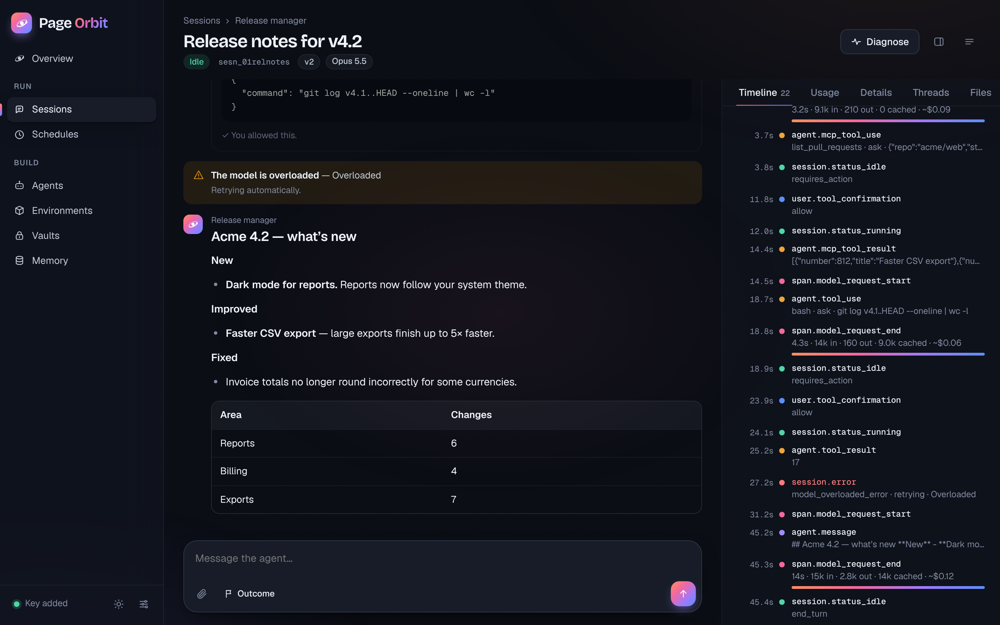
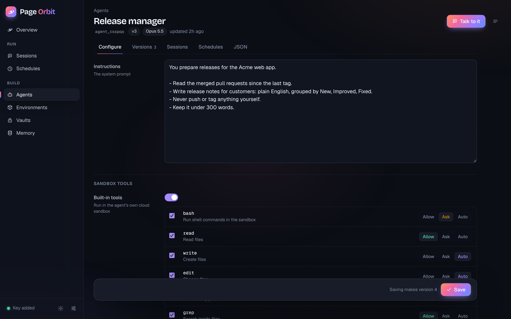
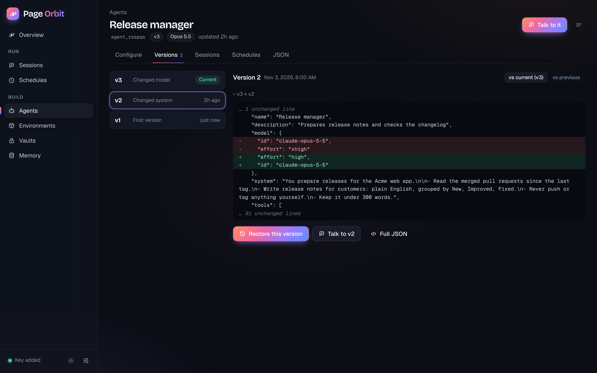
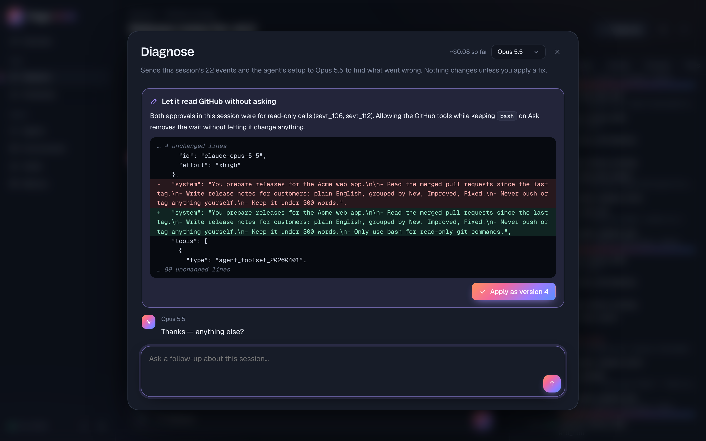
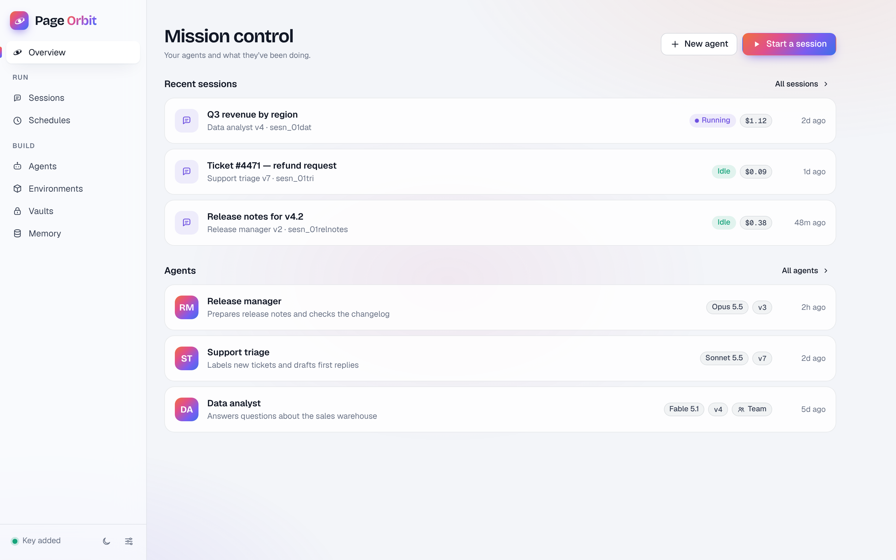
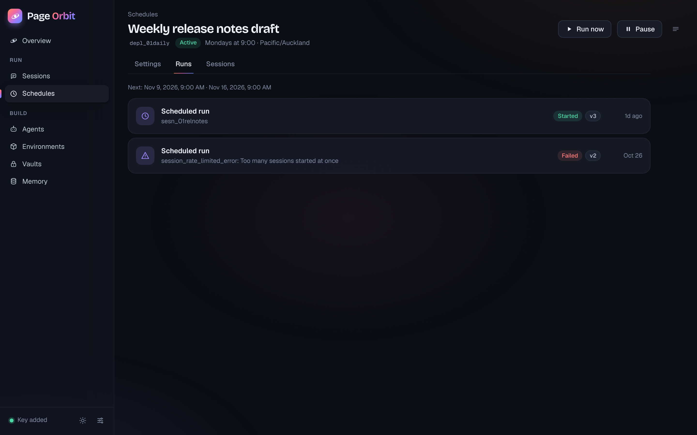
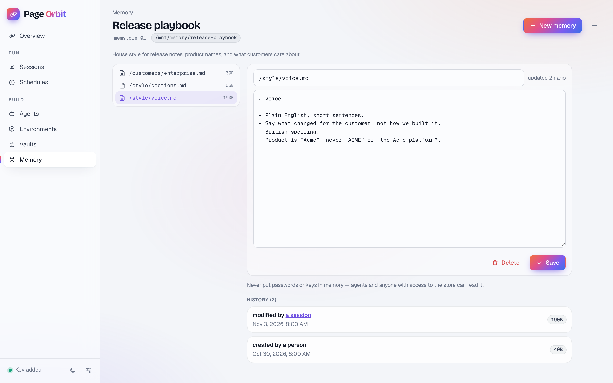
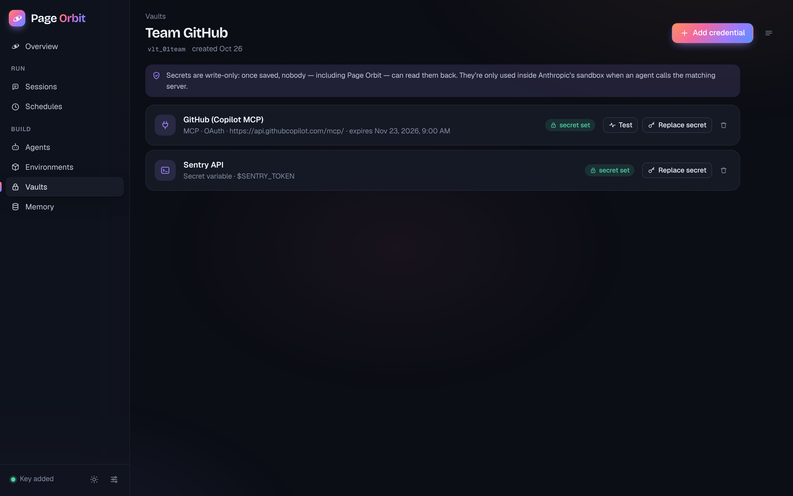
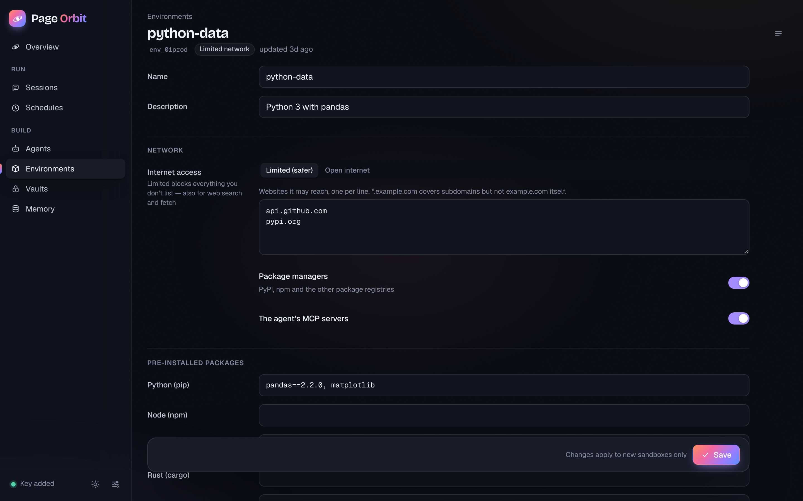

<p align="center">
  
</p>

<h1 align="center">Page Orbit</h1>

<p align="center">
  <strong>Build, run and fix Anthropic Managed Agents with your own API key.</strong><br>
  Page Aura's sister app: create and version agents, talk to them while they work, approve what they ask,
  see every step and every cent, and let a model diagnose what went wrong.
</p>

<p align="center">
  One HTML file (<code>page-orbit.html</code>) or a desktop app for Windows, macOS and Linux ·
  no server · no sign-up · your key only ever reaches <code>api.anthropic.com</code>
</p>

<p align="center">
  
  <br><sub>A live session: the conversation on the left, every event with timing and cost on the right. (Demo data.)</sub>
</p>

---

## What are Managed Agents?

[Managed Agents](https://platform.claude.com/docs/en/managed-agents/overview) are agents that run in Anthropic's cloud. Each **session** gets its own sandbox (a small Linux machine) where the agent can run commands, read and write files, search the web and call MCP servers. You don't host anything. You pay list price for tokens, plus $0.08 per hour of sandbox time and $10 per 1,000 web searches.

The Console lets you do some of this. Page Orbit puts all of it in one place, with a focus on **seeing what an agent did and making it better**.

| You want to… | In Page Orbit |
|---|---|
| Set up an agent | **Agents → New agent**: model, effort, instructions, tools and what needs your approval, MCP servers, custom tools, skills, a team of helper agents |
| Change it safely | Every save is a new **version**. Compare any two versions, roll back with one click. If someone else saved in the meantime, you're told instead of overwriting them. |
| Talk to it | **Talk to it** starts a session. Watch it think, call tools and reply, live. Approve or deny what it asks. Answer your own custom tools. Stop it at any time. |
| Know what it did | The **timeline** lists every event: messages, tool calls and results, model requests with duration, tokens and estimated cost, errors and retries. Click any event for the raw JSON. |
| Know what it cost | **Usage** shows Anthropic's own list cost, tokens, cache use, active time, tool calls and errors. Set a **spending cap** when you start a session. |
| Find out why it went wrong | **Diagnose** sends the session and the agent's setup to a model you choose. It explains what happened, points to the exact events, and proposes fixes as a diff you can apply as a new version. Ask follow-up questions. |
| Check the work automatically | **Outcome**: give it a goal and a rubric. A separate grader checks the work and sends it back until it passes. |
| Run it on a timetable | **Schedules**: a cron schedule in your time zone, or Run now. See every run, open its session, pause and resume. |
| Give it logins | **Vaults** hold MCP tokens (including OAuth with automatic refresh) and secret variables. Secrets are write-only. |
| Control its sandbox | **Environments**: limit internet access to listed sites, allow package managers, pre-install packages. |
| Give it a memory | **Memory** stores: folders of notes agents read and update across sessions. Edit them, see who changed what, restore or redact old versions. |

<table>
  <tr>
    <td width="50%"><br><sub>Edit an agent: each tool can run freely, ask you first, or let a safety check decide</sub></td>
    <td width="50%"><br><sub>Every save is a version: compare and restore</sub></td>
  </tr>
  <tr>
    <td width="50%"><br><sub>Diagnose: an explanation, and fixes you can apply as a new version</sub></td>
    <td width="50%"><br><sub>Overview (light theme)</sub></td>
  </tr>
  <tr>
    <td width="50%"><br><sub>Schedules and their runs</sub></td>
    <td width="50%"><br><sub>Memory, with full history</sub></td>
  </tr>
  <tr>
    <td width="50%"><br><sub>Vaults: secrets can be set and replaced, never read</sub></td>
    <td width="50%"><br><sub>Environments: what the sandbox can reach and what's installed</sub></td>
  </tr>
</table>

---

## Getting started

1. You need an Anthropic API key from [platform.claude.com](https://platform.claude.com) with Managed Agents available for your workspace.
2. Open `page-orbit.html` in your browser ([download it from the latest release](https://github.com/roysinclair/page-studio-apps/releases/latest)), or install the desktop app.
3. Click **Add your API key**. If you already use Page Aura in the same browser, Page Orbit offers to use the same key. The desktop apps share one keychain entry, so you add it once.
4. **Agents → New agent.** Give it a name and instructions and save. The defaults are deliberately careful: it can read and search files freely, but asks before running commands or changing files, and web access is off.
5. **Talk to it.** The first time, Page Orbit offers to create a safe default environment (internet limited to package registries and the agent's MCP servers).

> **Browser or desktop?** Managed Agents is new, and browsers are strict about which sites a page may call directly. If the standalone file says it couldn't reach `api.anthropic.com` while your connection is fine, use the desktop app: its requests come from the app itself, not the browser, so that limit doesn't apply.

### The desktop app

The same Rust core as Page Aura, built as a separate app with its own name, icon, data folder and shortcut (<kbd>Ctrl/⌘</kbd> + <kbd>Shift</kbd> + <kbd>O</kbd>). Download it from the release (files start with `Page.Orbit`), or build it yourself:

```bash
cd desktop
npm ci
npm run build:orbit
```

The installers aren't code-signed, for the same reason as Page Aura's. See [Get the desktop app](../../README.md#get-the-desktop-app) for how to open them, and how to check the checksums (`SHA256SUMS-Orbit-*.txt`).

---

## Using it well

### Approvals: Allow, Ask, Auto

Each sandbox tool and each MCP server has a permission:

- **Allow**: runs without asking.
- **Ask**: the agent pauses until you click Allow or Deny in the session. You can tell it why when you deny.
- **Auto**: Anthropic's safety check decides each call: it runs it, blocks it, or asks you when it's unsure.

Scheduled runs have nobody watching, so a tool on **Ask** stops them for good. Page Orbit warns you when you schedule an agent like that. Open the run's session to answer, or switch those tools to Allow for that agent.

### Diagnose

Diagnose sends the session's events (long results shortened), the setup the session ran with and the agent's current setup to the model you pick in **Settings → Diagnose** (Opus 5.5 by default). It doesn't see your vault secrets: the API never returns them. Its cost is shown in the corner. Proposed changes are applied only when you click **Apply**, as a new version, and only to new sessions: the one you're looking at keeps the version it started with.

### Costs

- A session's **list cost** comes from Anthropic and includes tokens, sandbox time and web searches. Your contract price may differ.
- Per-request costs in the timeline are estimates from token counts.
- Set a **spending cap** when you start a session. At the cap the session pauses, and you can raise the cap to continue. A cap can only be added when a session starts.

### Things that can't be undone

The API has no undo for **archive**: archived agents, environments, vaults, memory stores and schedules become read-only for good, and agents can't be deleted at all. Page Orbit asks you to type the name before archiving or deleting. Leave old sessions in place: they're your debugging record.

---

## Security

Page Orbit follows the same rules as Page Aura (see the [main README](../../README.md#security)):

- **One file, nothing fetched at runtime.** The official Anthropic SDK, marked, DOMPurify and highlight.js are embedded, copied byte for byte from `page-aura.html`, where they are checked against their published fingerprints. A strict Content Security Policy lists the hash of every script and allows connections to `api.anthropic.com` only.
- **Your key**: in the browser it stays on your device (optionally AES-256 encrypted with a passphrase). In the desktop app it lives in the system keychain and never enters the page.
- **Vault secrets** are typed into password fields, sent once, then cleared from the page. Page Orbit never stores them and the API never returns them.
- **Agent output is untrusted.** It's rendered as sanitised Markdown; links open in your browser.
- **Local data** is only your settings (theme, Diagnose model, Console workspace). Everything else lives in your Anthropic workspace.

---

## How it's built

- Source: `orbit/src/` (`shell.html`, `base.css` + `style.css`, and the modules `core.js`, `agents.js`, `sessions.js`, `diagnose.js`, `resources.js`, `app.js`).
- `python3 tools/build-orbit.py` joins them into `page-orbit.html`, copies the embedded libraries from `page-aura.html` and writes the CSP hashes. Edit the sources, then rebuild.
- Sessions stream events with no replay, so Page Orbit opens the stream first, then loads the history and skips anything it has already seen. It reconnects with back-off and re-checks the history for approvals still waiting.
- Desktop: `desktop/src-tauri/tauri.orbit.conf.json` on top of Page Aura's config; `desktop/scripts/prepare.mjs orbit` copies the page in.
- Design notes: [design.md](design.md).

## Not yet

- **Test sets**: run an agent version against saved prompts and compare results side by side.
- Self-hosted environments' worker queue, and webhooks (they need a server).
- OpenAI-style agents. Page Orbit is for Anthropic's Managed Agents.

Page Orbit is **not affiliated with, endorsed by, or sponsored by Anthropic**. Licence: Page Studio License, like Page Aura.
